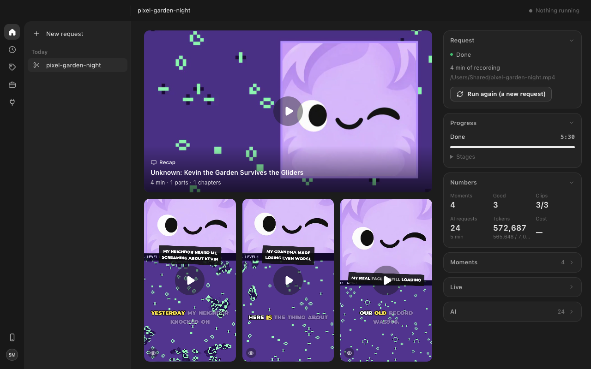

<!-- The source is the Russian README.md; translations: README.<language>.md, the same structure. A change to README.md
     changes README.en.md in the same PR; the other languages follow (each says it was translated automatically from
     the Russian original and links it and Weblate). Pictures: docs/images/. -->
<div align="center">

# Clip It!

**Turn a long stream into short clips and a recap. Free, on your own computer.**

It was called SMTV before.

<!-- languages -->
[Русский](README.md) · **English** · [Қазақша](README.kk.md) · [Oʻzbekcha](README.uz.md) · [Azərbaycanca](README.az.md) · [Кыргызча](README.ky.md) · [简体中文](README.zh-CN.md) · [日本語](README.ja.md) · [한국어](README.ko.md) · [Tiếng Việt](README.vi.md) · [Bahasa Indonesia](README.id.md) · [हिन्दी](README.hi.md) · [বাংলা](README.bn.md) · [Español](README.es.md) · [Português](README.pt-BR.md) · [Deutsch](README.de.md)

> 🌐 This page was translated automatically from the [Russian original](README.md). Help improve it: [Weblate](https://hosted.weblate.org/engage/smtv/) · [pull request](https://github.com/yuriti/clipit/pulls).

[](https://github.com/yuriti/clipit/releases/latest)
[](https://pepy.tech/projects/smtv)
[](https://github.com/yuriti/clipit/stargazers)
[](LICENSE)
[](https://pypi.org/project/smtv/)
[](https://hosted.weblate.org/engage/smtv/)


[**Download Clip It!**](#download) · [Step-by-step guides](docs/guide/en/README.md) · [How it compares](#how-clip-it-compares) · [Questions](#questions)

</div>

---

You streamed for six hours. Somewhere in there are the ten moments worth posting — but finding them means watching it
all again. **Clip It! watches it for you.** Paste a link to a Twitch or YouTube recording, or pick a video file, and Clip It!
listens to the whole stream, picks the best moments and gives you **ready-to-post vertical clips** for TikTok, Shorts
and Reels, with captions and the webcam on top, plus a **20–30 minute recap** of the whole stream for YouTube.

## What it does

| | |
|---|---|
| 🎬 **Clips that are ready to post** | Vertical 9:16, with big captions, a short title card at the start and the streamer's webcam on top of the game. |
| ⏱️ **Long streams are fine** | A 6–12 hour recording in, up to 30 clips out. Clips appear one by one: start posting before the rest are done. |
| 📺 **A recap of the whole stream** | A 20–30 minute video for YouTube: the stream itself, cut down to the parts worth watching. |
| 🗣️ **Many languages** | Russian, 25 European languages and dozens more. Clip It! turns speech into text right on your computer. |
| 🔒 **Your files stay with you** | Clips are made and kept on your computer. Nothing is uploaded to a website. |
| 💸 **Free and open** | MIT license: use it, share it, use it for clients. No watermark, no limit on minutes. |

## See it work

**Paste a link or pick a file — and watch the steps.** Every step is on screen: speech to text, finding moments,
rating them, editing each clip.


**Clips appear one by one.** Watch them right in Clip It!, download them, post them.


**Every clip comes with its text.** Read what was said and why Clip It! picked the moment.


**And a recap of the whole stream** for YouTube, made after the clips.


**Light or dark** — as on your computer.



<sub>The stream in these pictures is made up for the demo: a little game, a cartoon mascot instead of a webcam and a
computer voice. Nobody real is on screen.</sub>

## Free and open source

- **Clip It! is free.** The whole program is open source under the [MIT license](LICENSE): use it for yourself, for your
  channel or for clients, change it and share it.
- **No watermark, no minute limits, no subscription to Clip It!**
- **You pay only for the AI, and only if you want to.** Clip It! needs an AI to read the stream's text and choose the
  moments. That can be a free AI on your own computer, or a service you choose — see below.
- **Your data stays with you.** Clips are made and kept on your computer. Only the text of the stream goes to the AI
  you chose. With a free AI on your computer, nothing leaves it at all.

## Choose your AI: three ways

Clip It! turns the speech into text on your computer by itself. To pick the best moments it asks an AI. Choose one way —
one is enough, and you can change it any time in **Settings → AI**.

| | How | Costs | Good for |
|---|---|---|---|
| 🔑 **Your own key** | Already use OpenAI, Claude, Gemini or OpenRouter? Paste your key, and Clip It! uses it directly. | You pay that service directly; some have a free plan | People who already use an AI service. [Where to get a key](docs/guide/en/get-a-key.md) |
| 💻 **Free, on your computer** | Install Ollama or LM Studio and the Qwen AI; Clip It! finds it by itself. | Free | A computer with a strong graphics card. Clips come out weaker. [Guide](docs/guide/en/free-ai-on-your-computer.md) |
| 🕓 **StreamMoment subscription** — *coming soon* | Pay once a month, and Clip It! uses OpenAI's AI by itself: no keys, no setup. | A monthly subscription | Everyone who does not want to deal with keys and services. [More](#subscription--coming-soon) |

## What's next

Clip It! already works: pick a file with a stream recording, connect an AI and get clips and a recap. Here is what we are
working on now.

### Links to Twitch and YouTube — coming soon

Every program like this has the same trouble right now: you paste a link to a stream recording, and it cannot be
downloaded. Twitch and YouTube make downloading recordings harder and harder.

We are solving it our own way: the recording will be downloaded through our server, fast and with no setup. Paste a
link — done. This is the next update.

Until then: download the recording yourself and pick the file. Or turn on «**Download links myself**» in **Settings →
VodCut** — the yt-dlp program on your computer does it (**Settings → Computer check** installs it), but it does not
always work (YouTube may ask you to sign in).

### Which AI to choose

To find the best moments, Clip It! needs an AI: it reads the whole text of the stream, picks the interesting parts and
decides how to cut them. That is a lot of work, and it takes computing power.

**Free, on your own computer.** You can install an AI right on your computer, for example Qwen through Ollama or LM
Studio. It is free, and nothing goes to the internet. But honestly: the result depends a lot on which AI you install,
and the ones that fit on an ordinary computer often do not understand well what is really interesting in a stream. If
you have a powerful computer with a good graphics card, give it a try — something will come out.

**An AI on the internet.** Cloud AIs work much faster and make far better clips. I have tried several and recommend
OpenAI: paste your own key into Clip It! and pay the service directly, only for what you use. Cheaper: DeepSeek and
similar services. Need another AI? [Write to us](https://github.com/yuriti/clipit/issues/new?template=feature.yml)
— we will make Clip It! work with it.

### Subscription — coming soon

Nobody can do it entirely for free: an AI's work costs money, and nobody gives it away. So you do not have to deal with
keys and services, we will add a subscription: pay once a month, and Clip It! uses OpenAI's AI by itself. It will be
enough for about 50 streams, or about 90 hours of recordings a month (the numbers are preliminary).

The goal is not to make money but to give a simple way: pay, and everything works.

## Download

| Your computer | Download | Size |
|---|---|---|
| **Windows 10 or 11** (64-bit) | [**Clip It! for Windows**](https://github.com/yuriti/clipit/releases/latest/download/SMTV-windows.zip) (ZIP: unzip it and open **ClipIt.exe**) | about 100 MB |
| **Mac** — Apple silicon (M1 and newer) or Intel, macOS 13+ | [**Clip It! for Mac**](https://github.com/yuriti/clipit/releases/latest/download/SMTV-mac.dmg) | about 270 MB |

One file for every Mac: Clip It! starts the version made for your Mac's processor by itself.

Windows, with no installer: unzip the ZIP wherever you like (Documents, for example) and double-click **ClipIt.exe** in
the `ClipIt` folder. Everything, settings, keys and models included, is kept in that folder; clips are in its `Clips`
folder. Clip It! installs new versions from its window by itself, into the same folder.

Everything Clip It! needs is inside: the program, Python and ffmpeg with captions. Speech recognition is downloaded on the
first start, only for your language (0.9–2.5 GB, once): Clip It! offers it with one button, **Fix**.

**The first time, the system warns you.** Clip It! does not have a digital signature yet: the one for Windows comes a little
later, the one for macOS as soon as possible, and then this warning goes away. Until then:

- **Windows** («Windows protected your PC»): **More info** → **Run anyway**.
- **Mac**: open Clip It! once, then **System Settings → Privacy & Security** → **Open Anyway**.
- **Windows 11 with Smart App Control**: **ClipIt.exe** from the ZIP works with it on. If it does not open, install
  Clip It! with one line (below).

[Every step with pictures](docs/guide/en/install.md).

### For experienced users: one line in a terminal

The same Clip It!, installed with [uv](https://astral.sh/uv) into your user folder. It also works on **Linux** and with
**Smart App Control**, and updates from the window the same way.

**Windows** — press Start, type **PowerShell**, open it and paste:

```powershell
powershell -ExecutionPolicy ByPass -c "irm https://raw.githubusercontent.com/yuriti/clipit/main/install/install.ps1 | iex"
```

**Mac or Linux** — open **Terminal** and paste:

```bash
curl -LsSf https://raw.githubusercontent.com/yuriti/clipit/main/install/install.sh | sh
```

Press Enter and wait a few minutes. No administrator password is needed. An **Clip It!** icon appears — on the desktop and
in the Start menu on Windows, in Applications on a Mac, in the applications menu on Linux.

## Your first clip in three steps

1. **Choose an AI** — the window shows the three ways the first time ([which one?](docs/guide/en/connect-ai.md)).
2. **Pick a video file** from your computer, or paste a link to a Twitch or YouTube recording (links need
   [**Download links myself**](#links-to-twitch-and-youtube--coming-soon) turned on for now).
3. **Wait.** Clips appear one by one: watch, download, post.

The first time, Clip It! checks your computer and offers to fix what is missing with one button, **Fix**.
[The first clip, step by step](docs/guide/en/first-clip.md).

## Step-by-step guides

For people who are new to all this — every step, with pictures:

| | |
|---|---|
| [Install on Windows, Mac or Linux](docs/guide/en/install.md) | and what to do when the system warns you |
| [Your first clip](docs/guide/en/first-clip.md) | from a link or a file to a finished clip |
| [Which AI to choose](docs/guide/en/connect-ai.md) | the three ways, side by side |
| [A free AI on your computer](docs/guide/en/free-ai-on-your-computer.md) | Ollama or LM Studio with Qwen: which model fits your graphics card |
| [Where to get a key](docs/guide/en/get-a-key.md) | which services have a free or cheap plan, step by step |
| [The StreamMoment account](docs/guide/en/account.md) | coming soon: links through our server and a subscription |
| [Clip It! on your phone](docs/guide/en/phone.md) | scan a QR code and watch the clips on the phone |
| [Speech and languages](docs/guide/en/speech-and-languages.md) | which languages Clip It! understands |
| [Update and remove](docs/guide/en/update-and-remove.md) | |
| [Something went wrong](docs/guide/en/troubleshooting.md) | computer check, **Fix**, **Report a problem** |

## How Clip It! compares

The open-source clippers people use most, from each project's own code and documentation, **as of November 2026**.
They are good projects, each made for its own job; this table only shows where Clip It! is different. Something changed?
[Tell us](https://github.com/yuriti/clipit/issues/new?template=bug.yml) and we will fix the table.

| | **Clip It!** | [openshorts](https://github.com/mutonby/openshorts) | [SupoClip](https://github.com/FujiwaraChoki/supoclip) | [PeakCut](https://github.com/haziqahmedqasmi/PeakCut) | [FunClip](https://github.com/modelscope/FunClip) |
|---|---|---|---|---|---|
| License | **MIT** | MIT (the `cloud/` folder has its own license) | Noncommercial source license | MIT | MIT |
| A whole 6–12 hour stream | **Yes** | 60 minutes per job by default | 90 minutes by default | No length limit stated | Not made for streams |
| A long recap of the whole stream | **Yes, 20–30 minutes** | No | No (its «recap» is one short clip) | No | No |
| Russian speech | **GigaAM-v3, made for Russian** | Whisper or Parakeet v3 | AssemblyAI or Whisper | No (Parakeet v2, English only) | No (Chinese and English) |
| Streamer's webcam in the vertical frame | **Yes** | No | Gaming mode, off by default | Yes | No vertical clips |
| Speech to text by default | **On your computer, free** | On your computer | AssemblyAI, a paid service | On your computer | On your computer |
| How you start it | **Its own window and icon: a download for Windows and Mac, or one line** | Web page in Docker | Web page in Docker | Web page | Web page |

## Questions

<details>
<summary><b>Is it really free?</b></summary>

Yes. Clip It! itself costs nothing and has no limits. The only possible cost is the AI that picks the moments: free on
your own computer, or paid to the service whose key you use.
</details>

<details>
<summary><b>Do I need a StreamMoment account?</b></summary>

No. Clip It! works fully without it: give it your own key or a free AI on your computer, and a video file — or a link,
with **Download links myself** turned on. The account is coming soon and will give two things: links to Twitch and
YouTube through our server, and a subscription with which Clip It! uses OpenAI's AI by itself ([more](#whats-next)).
</details>

<details>
<summary><b>Do I need a powerful computer?</b></summary>

No graphics card is needed: Clip It! works on an ordinary computer, just slower. An NVIDIA card makes speech to text
faster. A free AI on your own computer is the exception — it needs a strong graphics card
([which one](docs/guide/en/free-ai-on-your-computer.md)). Free disk space: 5 GB at least, 20 GB for a 6-hour stream.
</details>

<details>
<summary><b>How long does it take?</b></summary>

Measured on a Mac with Apple silicon, without a graphics card: a 2.35-hour Twitch recording took about 6 minutes to
find the moments, then about 1 minute per clip; a 10.7-minute recap took 6.5 minutes. Before a request starts, Clip It!
shows how long it should take.
</details>

<details>
<summary><b>Which systems does it run on?</b></summary>

Windows 10 (version 1809) or newer, 64-bit; macOS 13 or newer on Apple silicon and Intel (on Apple silicon Clip It! runs
natively from macOS 14; on macOS 13 it runs its Intel version through Rosetta, slower); Linux (one-line install). Checked on Windows 11 and on Macs with Apple silicon; Intel Macs (only under Rosetta) and Linux
desktops are not tested yet.
</details>

<details>
<summary><b>Which languages does it understand?</b></summary>

Russian, 25 European languages and dozens of others. Clip It! finds the language of the stream by itself.
[Details](docs/guide/en/speech-and-languages.md).
</details>

<details>
<summary><b>Can I use the clips for my clients?</b></summary>

Yes. The MIT license allows any use, including commercial: clipping for streamers, agencies, your own channels.
Respect the rights of the streamer whose stream you clip.
</details>

<details>
<summary><b>Where do my clips go? Does anything get uploaded?</b></summary>

Clips stay on your computer. A video file of your own never leaves it. With **Download links myself** on, a link is
downloaded straight to your computer by yt-dlp. Once the StreamMoment account opens, a link can also go through it:
its server passes the recording to Clip It! in pieces and stores nothing. The text of the stream goes only to the AI you
chose. Keys to AI services stay on your computer and never appear in logs or problem reports.
</details>

<details>
<summary><b>Does it post to TikTok or YouTube by itself?</b></summary>

Not yet: you download the clips and post them yourself. Settings → About → «Coming» shows what is planned.
</details>

<details>
<summary><b>Something does not work.</b></summary>

Settings → **Computer check** → **Fix** solves most problems. Still stuck? Settings → Computer check → **Report…**: Clip It!
prepares a report without your keys and opens a page on GitHub; nothing is sent by itself.
[What to try](docs/guide/en/troubleshooting.md).
</details>

## Help translate Clip It!

Clip It!'s window speaks the language of your computer. Translations are made by people on
[Weblate](https://hosted.weblate.org/engage/smtv/) — no programming needed: open the page, pick your language,
translate a few lines. The translations of this page were made automatically; if you see a mistake, fix it in a pull
request. [How translations work](docs/translations.md).

[](https://hosted.weblate.org/engage/smtv/)

## StreamMoment

Clip It! is made by the [StreamMoment](https://streammoment.tv) team. A StreamMoment account is coming soon: it will give
Clip It! an AI and fetch links to recordings without any setup. Clip It! works fully without it.

- [Report a problem](https://github.com/yuriti/clipit/issues/new?template=bug.yml) · [Suggest an idea](https://github.com/yuriti/clipit/issues/new?template=feature.yml)
- [For advanced users](docs/advanced.md): Docker, every AI service, speech models, keys, commands
- [Changes](CHANGELOG.md) · [Contributing](CONTRIBUTING.md) · [Security](SECURITY.md)
- Like Clip It!? [Support it on Boosty](https://boosty.to/smtv) and give the repository a ⭐ — it helps others find it.

License: [MIT](LICENSE).
