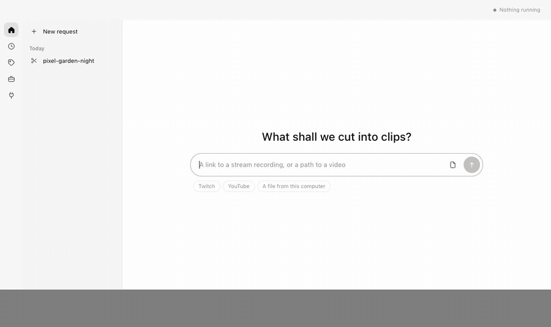
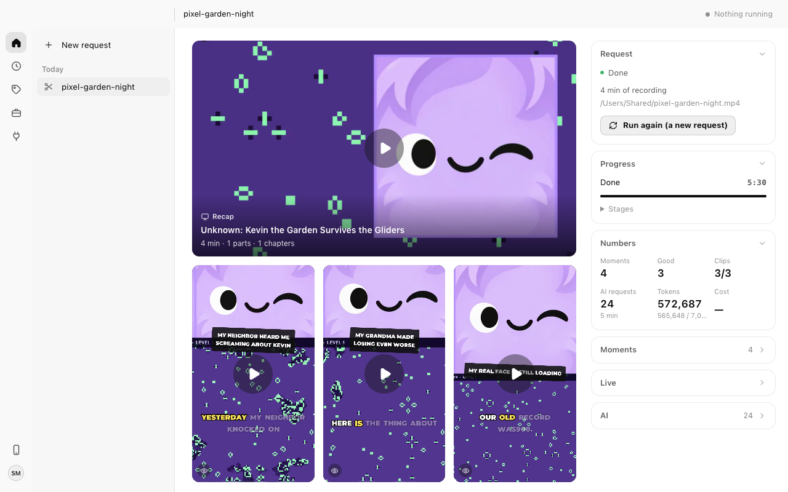

<!-- The source is the Russian README.md; translations: README.<language>.md, the same structure. A change to README.md
     changes README.en.md in the same PR; the other languages follow (each says it was translated automatically from
     the Russian original and links it and Weblate). Pictures: docs/images/. -->
<div align="center">

# SMTV

**लंबी स्ट्रीम से छोटी क्लिप और एक रीकैप बनाइए। मुफ़्त, आपके अपने कंप्यूटर पर।**

<!-- languages -->
[Русский](README.md) · [English](README.en.md) · [Қазақша](README.kk.md) · [Oʻzbekcha](README.uz.md) · [Azərbaycanca](README.az.md) · [Кыргызча](README.ky.md) · [简体中文](README.zh-CN.md) · [日本語](README.ja.md) · [한국어](README.ko.md) · [Tiếng Việt](README.vi.md) · [Bahasa Indonesia](README.id.md) · **हिन्दी** · [বাংলা](README.bn.md) · [Español](README.es.md) · [Português](README.pt-BR.md) · [Deutsch](README.de.md)

> 🌐 यह पेज अपने-आप अनुवाद किया गया है। इसे बेहतर बनाने में मदद करें: [Weblate](https://hosted.weblate.org/engage/smtv/) · [pull request](https://github.com/yuriti/clipit/pulls) · [मूल पाठ: Русский](README.md).

[](https://github.com/yuriti/clipit/releases/latest)
[](https://pepy.tech/projects/smtv)
[](https://github.com/yuriti/clipit/stargazers)
[](LICENSE)
[](https://pypi.org/project/smtv/)
[](https://hosted.weblate.org/engage/smtv/)



[**SMTV डाउनलोड करें**](#डाउनलोड-करें) · [कदम-दर-कदम गाइड](docs/guide/hi/README.md) · [तुलना](#smtv-दूसरों-से-कैसे-अलग-है) · [सवाल](#सवाल)

</div>

---

आपने छह घंटे स्ट्रीम की। उसमें कहीं दस ऐसे पल हैं जो पोस्ट करने लायक हैं — लेकिन उन्हें ढूँढने के लिए सब कुछ फिर से
देखना पड़ेगा। **SMTV यह आपके लिए देखता है।** Twitch या YouTube की रिकॉर्डिंग का लिंक पेस्ट करें, या कोई वीडियो फ़ाइल
चुनें, और SMTV पूरी स्ट्रीम सुनता है, सबसे अच्छे पल चुनता है और आपको TikTok, Shorts और Reels के लिए **पोस्ट करने को
तैयार वर्टिकल क्लिप** देता है, सबटाइटल और ऊपर वेबकैम के साथ, और साथ में YouTube के लिए पूरी स्ट्रीम का **20–30 मिनट का
रीकैप**।

## यह क्या करता है

| | |
|---|---|
| 🎬 **पोस्ट करने को तैयार क्लिप** | वर्टिकल 9:16, बड़े सबटाइटल, शुरुआत में एक छोटा टाइटल कार्ड और गेम के ऊपर स्ट्रीमर का वेबकैम। |
| ⏱️ **लंबी स्ट्रीम भी चलेगी** | 6–12 घंटे की रिकॉर्डिंग अंदर, 30 तक क्लिप बाहर। क्लिप एक-एक करके आती हैं: बाकी तैयार होने से पहले ही पोस्ट करना शुरू कर दें। |
| 📺 **पूरी स्ट्रीम का रीकैप** | YouTube के लिए 20–30 मिनट का वीडियो: वही स्ट्रीम, सिर्फ़ देखने लायक हिस्सों तक छोटी की हुई। |
| 🗣️ **कई भाषाएँ** | रूसी, 25 यूरोपीय भाषाएँ और दर्जनों दूसरी। SMTV बोली को आपके कंप्यूटर पर ही टेक्स्ट में बदलता है। |
| 🔒 **आपकी फ़ाइलें आपके पास रहती हैं** | क्लिप आपके कंप्यूटर पर बनती और रखी जाती हैं। किसी वेबसाइट पर कुछ अपलोड नहीं होता। |
| 💸 **मुफ़्त और ओपन** | MIT लाइसेंस: इस्तेमाल करें, शेयर करें, क्लाइंट्स के लिए इस्तेमाल करें। कोई वॉटरमार्क नहीं, मिनटों की कोई सीमा नहीं। |

## काम करते हुए देखें

**लिंक पेस्ट करें या फ़ाइल चुनें — और हर चरण देखें।** हर चरण स्क्रीन पर दिखता है: बोली से टेक्स्ट, पल ढूँढना, उन्हें
रेटिंग देना, हर क्लिप की एडिटिंग।


**क्लिप एक-एक करके आती हैं।** उन्हें सीधे SMTV में देखें, डाउनलोड करें, पोस्ट करें।



**हर क्लिप के साथ उसका टेक्स्ट आता है।** पढ़ें कि क्या कहा गया और SMTV ने वह पल क्यों चुना।


**और पूरी स्ट्रीम का रीकैप** YouTube के लिए, क्लिप के बाद बनता है।


**लाइट या डार्क** — जैसा आपके कंप्यूटर पर है।


<sub>इन तस्वीरों की स्ट्रीम डेमो के लिए बनाई गई है: एक छोटा गेम, वेबकैम की जगह एक कार्टून मैस्कॉट और कंप्यूटर की आवाज़।
स्क्रीन पर कोई असली इंसान नहीं है।</sub>

## मुफ़्त और ओपन सोर्स

- **SMTV मुफ़्त है।** पूरा प्रोग्राम [MIT लाइसेंस](LICENSE) के तहत ओपन सोर्स है: इसे अपने लिए, अपने चैनल के लिए या
  क्लाइंट्स के लिए इस्तेमाल करें, बदलें और शेयर करें।
- **कोई वॉटरमार्क नहीं, मिनटों की कोई सीमा नहीं, SMTV की कोई सब्सक्रिप्शन नहीं।**
- **आप सिर्फ़ AI के पैसे देते हैं, और वह भी तभी जब आप चाहें।** स्ट्रीम का टेक्स्ट पढ़ने और पल चुनने के लिए SMTV को
  एक AI चाहिए। यह आपके अपने कंप्यूटर पर मुफ़्त AI हो सकता है, या आपकी चुनी हुई कोई सर्विस — नीचे देखें।
- **आपका डेटा आपके पास रहता है।** क्लिप आपके कंप्यूटर पर बनती और रखी जाती हैं। सिर्फ़ स्ट्रीम का टेक्स्ट आपके चुने
  हुए AI तक जाता है। आपके कंप्यूटर पर मुफ़्त AI हो, तो कुछ भी बाहर नहीं जाता।

## अपना AI चुनें: तीन तरीके

SMTV बोली को आपके कंप्यूटर पर खुद टेक्स्ट में बदलता है। सबसे अच्छे पल चुनने के लिए वह एक AI से पूछता है। एक तरीका
चुनें — एक ही काफ़ी है, और आप इसे कभी भी **Settings → AI** (सेटिंग्स → AI) में बदल सकते हैं।

| | कैसे | खर्च | किसके लिए अच्छा |
|---|---|---|---|
| ⭐ **अकाउंट के ज़रिए** | StreamMoment अकाउंट में साइन इन करें (Google, Twitch या Telegram) और बैलेंस टॉप अप करें। बस: न कोई कुंजी (API key), न कोई सेटअप। | बैलेंस से, जितना इस्तेमाल उतना भुगतान | सबके लिए: सबसे आसान तरीका। रिकॉर्डिंग के **लिंक** पेस्ट करने के लिए भी ज़रूरी। [गाइड](docs/guide/hi/account.md) |
| 🔑 **आपकी अपनी कुंजी** | पहले से OpenAI, Claude, Gemini या OpenRouter इस्तेमाल करते हैं? अपनी कुंजी पेस्ट करें, और SMTV उसे सीधे इस्तेमाल करेगा। | आप सीधे उस सर्विस को भुगतान करते हैं; कुछ का फ़्री प्लान है | जो पहले से कोई AI सर्विस इस्तेमाल करते हैं। [कुंजी कहाँ से लें](docs/guide/hi/get-a-key.md) |
| 💻 **मुफ़्त, आपके कंप्यूटर पर** | Ollama या LM Studio और एक Qwen मॉडल इंस्टॉल करें; SMTV उसे खुद ढूँढ लेता है। | मुफ़्त | ताकतवर ग्राफ़िक्स कार्ड वाला कंप्यूटर। क्लिप कमज़ोर बनती हैं। [गाइड](docs/guide/hi/free-ai-on-your-computer.md) |

## डाउनलोड करें

| आपका कंप्यूटर | डाउनलोड | साइज़ |
|---|---|---|
| **Windows 10 या 11** (64-बिट) | [**Windows के लिए SMTV**](https://github.com/yuriti/clipit/releases/latest/download/SMTV-windows.zip) (इंस्टॉलर) | करीब 130 MB |
| **Mac** — Apple silicon (M1 और नए) या Intel, macOS 13+ | [**Mac के लिए SMTV**](https://github.com/yuriti/clipit/releases/latest/download/SMTV-mac.dmg) | करीब 270 MB |

हर Mac के लिए एक ही फ़ाइल: SMTV आपके Mac के प्रोसेसर के लिए बना वर्ज़न खुद चलाता है। Windows पर बिना कुछ इंस्टॉल किए:
[ZIP फ़ाइल](https://github.com/yuriti/clipit/releases/latest/download/SMTV-windows.zip) — उसे अनज़िप करें और
**SMTV.exe** खोलें।

SMTV को जो कुछ चाहिए, सब अंदर है: प्रोग्राम, Python और कैप्शन के साथ ffmpeg। बोली पहचानने वाला हिस्सा पहली बार शुरू
करने पर डाउनलोड होता है, सिर्फ़ आपकी भाषा के लिए (0.9–2.5 GB, एक बार): SMTV इसे एक बटन **Fix** (ठीक करें) से देता है।

**पहली बार सिस्टम चेतावनी देता है।** SMTV के पास अभी डिजिटल साइन नहीं है: Windows का साइन थोड़ा बाद में आएगा, macOS
का जितनी जल्दी हो सके, और फिर यह चेतावनी चली जाएगी। तब तक:

- **Windows** («Windows protected your PC»): **More info** → **Run anyway**।
- **Mac**: SMTV को एक बार खोलें, फिर **System Settings → Privacy & Security** → **Open Anyway**।
- **Smart App Control वाला Windows 11** बिना साइन वाले प्रोग्राम पूरी तरह रोक देता है, और उन्हें चलने देने का कोई बटन
  नहीं है। नीचे दिया एक लाइन वाला इंस्टॉल इस्तेमाल करें: यह Smart App Control चालू होने पर भी काम करता है। जब SMTV साइन
  हो जाएगा, तो वहाँ डाउनलोड भी काम करेगा।

[हर कदम, तस्वीरों के साथ](docs/guide/hi/install.md)।

### अनुभवी यूज़र्स के लिए: टर्मिनल में एक लाइन

वही SMTV, [uv](https://astral.sh/uv) से आपके यूज़र फ़ोल्डर में इंस्टॉल। यह **Linux** पर और **Smart App Control** के साथ
भी काम करता है, और विंडो से उसी तरह अपडेट होता है।

**Windows** — Start दबाएँ, **PowerShell** टाइप करें, उसे खोलें और पेस्ट करें:

```powershell
powershell -ExecutionPolicy ByPass -c "irm https://raw.githubusercontent.com/yuriti/clipit/main/install/install.ps1 | iex"
```

**Mac या Linux** — **Terminal** खोलें और पेस्ट करें:

```bash
curl -LsSf https://raw.githubusercontent.com/yuriti/clipit/main/install/install.sh | sh
```

Enter दबाएँ और कुछ मिनट इंतज़ार करें। एडमिनिस्ट्रेटर पासवर्ड की ज़रूरत नहीं। एक **SMTV** आइकन आ जाता है — Windows पर
डेस्कटॉप और Start मेन्यू में, Mac पर Applications में, Linux पर ऐप्लिकेशन मेन्यू में।

## तीन कदमों में आपकी पहली क्लिप

1. **AI चुनें** — पहली बार विंडो तीनों तरीके दिखाती है ([कौन-सा?](docs/guide/hi/connect-ai.md))।
2. Twitch या YouTube रिकॉर्डिंग का **लिंक पेस्ट करें**, या अपने कंप्यूटर से कोई वीडियो फ़ाइल चुनें।
3. **इंतज़ार करें।** क्लिप एक-एक करके आती हैं: देखें, डाउनलोड करें, पोस्ट करें।

पहली बार SMTV आपका कंप्यूटर जाँचता है और जो कमी है उसे एक बटन **Fix** (ठीक करें) से ठीक करने का सुझाव देता है।
[पहली क्लिप, कदम-दर-कदम](docs/guide/hi/first-clip.md)।

## कदम-दर-कदम गाइड

उनके लिए जो यह सब पहली बार कर रहे हैं — हर कदम, तस्वीरों के साथ:

| | |
|---|---|
| [Windows, Mac या Linux पर इंस्टॉल करें](docs/guide/hi/install.md) | और सिस्टम चेतावनी दे तो क्या करें |
| [आपकी पहली क्लिप](docs/guide/hi/first-clip.md) | लिंक या फ़ाइल से तैयार क्लिप तक |
| [कौन-सा AI चुनें](docs/guide/hi/connect-ai.md) | तीनों तरीके, साथ-साथ |
| [आपके कंप्यूटर पर मुफ़्त AI](docs/guide/hi/free-ai-on-your-computer.md) | Qwen के साथ Ollama या LM Studio: कौन-सा मॉडल आपके ग्राफ़िक्स कार्ड पर चलेगा |
| [कुंजी कहाँ से लें](docs/guide/hi/get-a-key.md) | किन सर्विसेज़ का फ़्री या सस्ता प्लान है, कदम-दर-कदम |
| [StreamMoment अकाउंट](docs/guide/hi/account.md) | साइन इन, बैलेंस |
| [फ़ोन पर SMTV](docs/guide/hi/phone.md) | QR कोड स्कैन करें और फ़ोन पर क्लिप देखें |
| [बोली और भाषाएँ](docs/guide/hi/speech-and-languages.md) | SMTV कौन-सी भाषाएँ समझता है |
| [अपडेट करना और हटाना](docs/guide/hi/update-and-remove.md) | |
| [कुछ गड़बड़ हो गई](docs/guide/hi/troubleshooting.md) | कंप्यूटर जाँच, **Fix**, **Report a problem** (समस्या की रिपोर्ट) |

## SMTV दूसरों से कैसे अलग है

सबसे ज़्यादा इस्तेमाल होने वाले ओपन-सोर्स क्लिपर, हर प्रोजेक्ट के अपने कोड और डॉक्यूमेंटेशन के आधार पर, **नवंबर 2026
तक**। ये अच्छे प्रोजेक्ट हैं, हर एक अपने काम के लिए बना है; यह टेबल सिर्फ़ यह दिखाती है कि SMTV कहाँ अलग है। कुछ बदल
गया? [हमें बताएँ](https://github.com/yuriti/clipit/issues/new?template=bug.yml) और हम टेबल ठीक कर देंगे।

| | **SMTV** | [openshorts](https://github.com/mutonby/openshorts) | [SupoClip](https://github.com/FujiwaraChoki/supoclip) | [PeakCut](https://github.com/haziqahmedqasmi/PeakCut) | [FunClip](https://github.com/modelscope/FunClip) |
|---|---|---|---|---|---|
| लाइसेंस | **MIT** | MIT (`cloud/` फ़ोल्डर का अपना लाइसेंस है) | नॉन-कमर्शियल सोर्स लाइसेंस | MIT | MIT |
| पूरी 6–12 घंटे की स्ट्रीम | **हाँ** | डिफ़ॉल्ट रूप से एक काम में 60 मिनट | डिफ़ॉल्ट रूप से 90 मिनट | लंबाई की कोई सीमा नहीं बताई गई | स्ट्रीम के लिए नहीं बना |
| पूरी स्ट्रीम का लंबा रीकैप | **हाँ, 20–30 मिनट** | नहीं | नहीं (उसका «recap» एक छोटी क्लिप है) | नहीं | नहीं |
| रूसी बोली | **GigaAM-v3, रूसी के लिए बना** | Whisper या Parakeet v3 | AssemblyAI या Whisper | नहीं (Parakeet v2, सिर्फ़ अंग्रेज़ी) | नहीं (चीनी और अंग्रेज़ी) |
| वर्टिकल फ़्रेम में स्ट्रीमर का वेबकैम | **हाँ** | नहीं | गेमिंग मोड, डिफ़ॉल्ट रूप से बंद | हाँ | वर्टिकल क्लिप नहीं |
| डिफ़ॉल्ट रूप से बोली से टेक्स्ट | **आपके कंप्यूटर पर, मुफ़्त** | आपके कंप्यूटर पर | AssemblyAI, एक पेड सर्विस | आपके कंप्यूटर पर | आपके कंप्यूटर पर |
| इसे कैसे शुरू करते हैं | **अपनी विंडो और आइकन: Windows और Mac के लिए डाउनलोड, या एक लाइन** | Docker में वेब पेज | Docker में वेब पेज | वेब पेज | वेब पेज |

## सवाल

<details>
<summary><b>क्या यह सच में मुफ़्त है?</b></summary>

हाँ। SMTV खुद कुछ नहीं लेता और इसकी कोई सीमा नहीं है। एकमात्र संभावित खर्च वह AI है जो पल चुनता है: आपके अपने
कंप्यूटर पर मुफ़्त, या आपकी चुनी हुई सर्विस को भुगतान (StreamMoment अकाउंट से या आपकी अपनी कुंजी से)।
</details>

<details>
<summary><b>क्या मुझे ताकतवर कंप्यूटर चाहिए?</b></summary>

ग्राफ़िक्स कार्ड की ज़रूरत नहीं: SMTV साधारण कंप्यूटर पर भी चलता है, बस धीमा। NVIDIA कार्ड बोली से टेक्स्ट को तेज़ कर
देता है। अपवाद है आपके अपने कंप्यूटर पर मुफ़्त AI — उसे ताकतवर ग्राफ़िक्स कार्ड चाहिए
([कौन-सा](docs/guide/hi/free-ai-on-your-computer.md))। डिस्क पर खाली जगह: कम से कम 5 GB, 6 घंटे की स्ट्रीम के लिए 20 GB।
</details>

<details>
<summary><b>कितना समय लगता है?</b></summary>

Apple silicon वाले Mac पर, बिना ग्राफ़िक्स कार्ड के, नापा गया: 2.35 घंटे की Twitch रिकॉर्डिंग में पल ढूँढने में करीब
6 मिनट लगे, फिर हर क्लिप पर करीब 1 मिनट; 10.7 मिनट के रीकैप में 6.5 मिनट लगे। रिक्वेस्ट शुरू होने से पहले SMTV दिखाता
है कि इसमें कितना समय लगना चाहिए।
</details>

<details>
<summary><b>यह किन सिस्टम पर चलता है?</b></summary>

Windows 10 (वर्ज़न 1809) या नया, 64-बिट; Apple silicon और Intel पर macOS 13 या नया (Apple silicon पर SMTV macOS 14 से सीधे चलता है; macOS 13 पर वह अपना Intel वर्ज़न Rosetta के ज़रिए चलाता है, धीमा); Linux (एक
लाइन वाला इंस्टॉल)। Windows 11 और Apple silicon वाले Mac पर जाँचा गया; Intel Mac (सिर्फ़ Rosetta के ज़रिए) और Linux
डेस्कटॉप अभी टेस्ट नहीं हुए हैं।
</details>

<details>
<summary><b>यह कौन-सी भाषाएँ समझता है?</b></summary>

रूसी, 25 यूरोपीय भाषाएँ और दर्जनों दूसरी। SMTV स्ट्रीम की भाषा खुद पहचान लेता है।
[विवरण](docs/guide/hi/speech-and-languages.md)।
</details>

<details>
<summary><b>क्या मैं क्लिप अपने क्लाइंट्स के लिए इस्तेमाल कर सकता हूँ?</b></summary>

हाँ। MIT लाइसेंस किसी भी इस्तेमाल की इजाज़त देता है, कमर्शियल भी: स्ट्रीमर्स के लिए क्लिपिंग, एजेंसियाँ, आपके अपने
चैनल। जिस स्ट्रीमर की स्ट्रीम आप क्लिप करते हैं, उसके अधिकारों का सम्मान करें।
</details>

<details>
<summary><b>मेरी क्लिप कहाँ जाती हैं? क्या कुछ अपलोड होता है?</b></summary>

क्लिप आपके कंप्यूटर पर रहती हैं। आपकी अपनी वीडियो फ़ाइल कभी बाहर नहीं जाती। लिंक StreamMoment अकाउंट के ज़रिए लाया
जाता है: उसका सर्वर रिकॉर्डिंग को टुकड़ों में SMTV तक पहुँचाता है और कुछ भी स्टोर नहीं करता। स्ट्रीम का टेक्स्ट सिर्फ़
आपके चुने हुए AI तक जाता है। AI सर्विसेज़ की कुंजियाँ आपके कंप्यूटर पर रहती हैं और लॉग या समस्या रिपोर्ट में कभी नहीं दिखतीं।
</details>

<details>
<summary><b>क्या यह TikTok या YouTube पर खुद पोस्ट करता है?</b></summary>

अभी नहीं: आप क्लिप डाउनलोड करके खुद पोस्ट करते हैं। Settings → About → «Coming» (सेटिंग्स → जानकारी → जल्द आ रहा)
दिखाता है कि आगे क्या आने वाला है।
</details>

<details>
<summary><b>कुछ काम नहीं कर रहा।</b></summary>

Settings → **Computer check** → **Fix** (सेटिंग्स → कंप्यूटर जाँच → ठीक करें) ज़्यादातर समस्याएँ सुलझा देता है। फिर भी
अटके हैं? Settings → Computer check → **Report…**: SMTV आपकी कुंजियाँ हटाकर एक रिपोर्ट तैयार करता है और GitHub पर एक पेज
खोलता है; अपने-आप कुछ नहीं भेजा जाता।
[क्या आज़माएँ](docs/guide/hi/troubleshooting.md)।
</details>

## SMTV का अनुवाद करने में मदद करें

SMTV की विंडो आपके कंप्यूटर की भाषा बोलती है। अनुवाद लोग [Weblate](https://hosted.weblate.org/engage/smtv/) पर करते
हैं — प्रोग्रामिंग की ज़रूरत नहीं: पेज खोलें, अपनी भाषा चुनें, कुछ लाइनें अनुवाद करें। इस पेज के अनुवाद अपने-आप बनाए
गए हैं; कोई गलती दिखे, तो pull request में ठीक करें। [अनुवाद कैसे काम करते हैं](docs/translations.md)।

[](https://hosted.weblate.org/engage/smtv/)

## StreamMoment

SMTV को [StreamMoment](https://streammoment.tv) टीम बनाती है। StreamMoment अकाउंट SMTV को AI देने और रिकॉर्डिंग के
लिंक पेस्ट करने का सबसे आसान तरीका है; SMTV इसके बिना भी काम करता है।

- [समस्या की रिपोर्ट करें](https://github.com/yuriti/clipit/issues/new?template=bug.yml) · [आइडिया सुझाएँ](https://github.com/yuriti/clipit/issues/new?template=feature.yml)
- [एडवांस्ड यूज़र्स के लिए](docs/advanced.md): Docker, हर AI सर्विस, बोली के मॉडल, कुंजियाँ, कमांड
- [बदलाव](CHANGELOG.md) · [योगदान](CONTRIBUTING.md) · [सुरक्षा](SECURITY.md)
- SMTV पसंद आया? [Boosty पर सपोर्ट करें](https://boosty.to/smtv) और रिपॉज़िटरी को ⭐ दें — इससे दूसरों को इसे ढूँढने में
  मदद मिलती है।

लाइसेंस: [MIT](LICENSE)।
