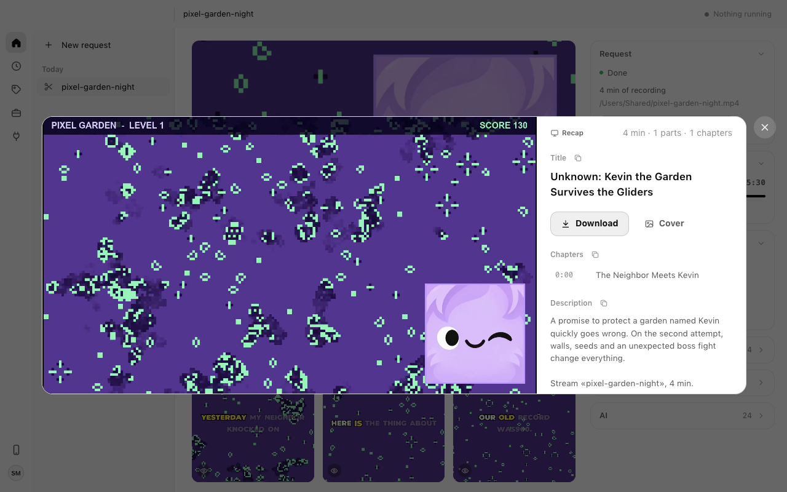

<!-- The source is the Russian README.md; translations: README.<language>.md, the same structure. A change to README.md
     changes README.en.md in the same PR; the other languages follow (each says it was translated automatically from
     the Russian original and links it and Weblate). Pictures: docs/images/. -->
<div align="center">

# SMTV

**Ұзақ стримді қысқа клиптерге және шолуға айналдырыңыз. Тегін, өз компьютеріңізде.**

<!-- languages -->
[Русский](README.md) · [English](README.en.md) · **Қазақша** · [Oʻzbekcha](README.uz.md) · [Azərbaycanca](README.az.md) · [Кыргызча](README.ky.md) · [简体中文](README.zh-CN.md) · [日本語](README.ja.md) · [한국어](README.ko.md) · [Tiếng Việt](README.vi.md) · [Bahasa Indonesia](README.id.md) · [हिन्दी](README.hi.md) · [বাংলা](README.bn.md) · [Español](README.es.md) · [Português](README.pt-BR.md) · [Deutsch](README.de.md)

> 🌐 Бұл бет автоматты түрде аударылған. Оны жақсартуға көмектесіңіз: [Weblate](https://hosted.weblate.org/engage/smtv/) · [pull request](https://github.com/yuriti/clipit/pulls) · [Түпнұсқа: Русский](README.md).

[](https://github.com/yuriti/clipit/releases/latest)
[](https://pepy.tech/projects/smtv)
[](https://github.com/yuriti/clipit/stargazers)
[](LICENSE)
[](https://pypi.org/project/smtv/)
[](https://hosted.weblate.org/engage/smtv/)


[**SMTV жүктеп алу**](#жүктеп-алу) · [Қадамдық нұсқаулықтар](docs/guide/kk/README.md) · [Басқалардан айырмашылығы](#smtv-басқалардан-несімен-ерекшеленеді) · [Сұрақтар](#сұрақтар)

</div>

---

Сіз алты сағат стрим жүргіздіңіз. Оның ішінде жариялауға тұрарлық он сәт бар — бірақ оларды табу үшін бәрін қайта
көру керек. **SMTV сіздің орныңызға көреді.** Twitch немесе YouTube жазбасының сілтемесін қойыңыз немесе бейнефайл
таңдаңыз — SMTV бүкіл стримді тыңдап, ең жақсы сәттерді таңдайды және TikTok, Shorts пен Reels үшін субтитрлері бар,
үстінде веб-камерасы бар **жариялауға дайын тік клиптерді**, сондай-ақ YouTube үшін бүкіл стримнің **20–30 минуттық
шолуын** береді.

## Не істейді

| | |
|---|---|
| 🎬 **Жариялауға дайын клиптер** | Тік 9:16, ірі субтитрлермен, басында қысқа тақырып заставкасымен және ойынның үстінде стримердің веб-камерасымен. |
| ⏱️ **Ұзақ стримдер — проблема емес** | Кірісте 6–12 сағаттық жазба, шығыста 30-ға дейін клип. Клиптер бірінен соң бірі шығады: қалғаны дайындалып жатқанда жариялай беріңіз. |
| 📺 **Бүкіл стримнің шолуы** | YouTube үшін 20–30 минуттық бейне: көруге тұрарлық бөліктері ғана қалған стримнің өзі. |
| 🗣️ **Көп тіл** | Орыс тілі, 25 еуропа тілі және тағы ондаған тіл. SMTV сөзді мәтінге тікелей сіздің компьютеріңізде айналдырады. |
| 🔒 **Файлдарыңыз өзіңізде қалады** | Клиптер сіздің компьютеріңізде жасалады және сақталады. Ешнәрсе сайтқа жүктелмейді. |
| 💸 **Тегін және ашық** | MIT лицензиясы: пайдаланыңыз, бөлісіңіз, клиенттер үшін жұмыс істеңіз. Су таңбасы да, минут шектеуі де жоқ. |

## Қалай жұмыс істейді

**Сілтеме қойыңыз немесе файл таңдаңыз — және қадамдарды бақылаңыз.** Әр қадам экранда: сөзді мәтінге айналдыру,
сәттерді іздеу, оларды бағалау, әр клипті монтаждау.


**Клиптер бірінен соң бірі шығады.** Оларды тікелей SMTV ішінде көріңіз, жүктеп алыңыз, жариялаңыз.


**Әр клиптің өз мәтіні бар.** Не айтылғанын және SMTV бұл сәтті неге таңдағанын оқыңыз.


**Және YouTube үшін бүкіл стримнің шолуы** — клиптерден кейін жасалады.



**Ашық немесе қараңғы тақырып** — компьютеріңіздегідей.


<sub>Бұл суреттердегі стрим демонстрация үшін ойдан шығарылған: шағын ойын, веб-камераның орнына мультфильм тұмары және
компьютер дауысы. Экранда нақты адамдар жоқ.</sub>

## Тегін және ашық кодты

- **SMTV тегін.** Бүкіл бағдарлама [MIT лицензиясы](LICENSE) бойынша ашық код: өзіңіз үшін, арнаңыз үшін немесе
  клиенттер үшін пайдаланыңыз, өзгертіңіз және бөлісіңіз.
- **Су таңбасы жоқ, минут шектеуі жоқ, SMTV-ге жазылым жоқ.**
- **Тек ЖИ үшін төлейсіз, оның өзінде де қаласаңыз ғана.** Стримнің мәтінін оқып, сәттерді таңдау үшін SMTV-ге
  жасанды интеллект (ЖИ) керек. Бұл өз компьютеріңіздегі тегін ЖИ немесе өзіңіз таңдаған сервис болуы мүмкін —
  төменде қараңыз.
- **Деректеріңіз өзіңізде қалады.** Клиптер сіздің компьютеріңізде жасалады және сақталады. Таңдаған ЖИ-ге тек
  стримнің мәтіні жіберіледі. Компьютердегі тегін ЖИ-мен ешнәрсе сыртқа шықпайды.

## ЖИ таңдаңыз: үш жол

SMTV сөзді мәтінге компьютеріңізде өзі айналдырады. Ең жақсы сәттерді таңдау үшін ол ЖИ-ден сұрайды. Бір жолды
таңдаңыз — біреуі жеткілікті, оны кез келген уақытта **Settings → AI** (Баптаулар → ЖИ) бөлімінде өзгертуге болады.

| | Қалай | Құны | Кімге жарайды |
|---|---|---|---|
| ⭐ **Аккаунт арқылы** (Through the account) | StreamMoment аккаунтына (Google, Twitch немесе Telegram) кіріп, балансты толтырыңыз. Болды: кілт те, баптау да керек емес. | Баланстан пайдаланғаныңызша төлейсіз | Барлығына: ең оңай жол. **Сілтемелерді** қою үшін де керек. [Нұсқаулық](docs/guide/kk/account.md) |
| 🔑 **Өз кілтіңіз** (Your own key) | OpenAI, Claude, Gemini немесе OpenRouter пайдаланасыз ба? Кілтіңізді қойыңыз, SMTV оны тікелей пайдаланады. | Сол сервиске тікелей төлейсіз; кейбірінде тегін тариф бар | ЖИ сервисін қазірдің өзінде пайдаланатындарға. [Кілтті қайдан алуға болады](docs/guide/kk/get-a-key.md) |
| 💻 **Тегін, компьютеріңізде** (Free, on this computer) | Ollama немесе LM Studio мен Qwen моделін орнатыңыз; SMTV оны өзі табады. | Тегін | Қуатты бейнекартасы бар компьютерге. Клиптер әлсіздеу шығады. [Нұсқаулық](docs/guide/kk/free-ai-on-your-computer.md) |

## Жүктеп алу

| Компьютеріңіз | Жүктеп алу | Көлемі |
|---|---|---|
| **Windows 10 немесе 11** (64-биттік) | [**Windows-қа арналған SMTV**](https://github.com/yuriti/clipit/releases/latest/download/SMTV-windows.zip) (орнатқыш) | шамамен 130 МБ |
| **Mac** — Apple silicon (M1 және жаңарағы) немесе Intel, macOS 13+ | [**Mac-қа арналған SMTV**](https://github.com/yuriti/clipit/releases/latest/download/SMTV-mac.dmg) | шамамен 270 МБ |

Барлық Mac-қа бір файл: SMTV Mac-ыңыздың процессорына арналған нұсқаны өзі іске қосады. Windows-та ештеңе орнатпай:
[ZIP мұрағаты](https://github.com/yuriti/clipit/releases/latest/download/SMTV-windows.zip) — оны мұрағаттан шығарып, **SMTV.exe** ашыңыз.

SMTV-ге керектің бәрі ішінде: бағдарламаның өзі, Python және субтитрлері бар ffmpeg. Сөзді тану алғаш іске қосқанда
тек сіздің тіліңіз үшін жүктеледі (0,9–2,5 ГБ, бір рет): SMTV оны бір түймемен ұсынады — **Fix** (Түзету).

**Алғаш рет жүйе ескерту береді.** SMTV-де әзірге цифрлық қолтаңба жоқ: Windows-қа арналған қолтаңба сәл кейінірек,
macOS-қа арналғаны мүмкіндігінше тезірек пайда болады, сонда бұл ескерту жоғалады. Оған дейін:

- **Windows** («Windows protected your PC»): **More info** → **Run anyway**.
- **Mac**: SMTV-ді бір рет ашыңыз, содан кейін **System Settings → Privacy & Security** → **Open Anyway**.
- **Smart App Control қосулы Windows 11** қолтаңбасыз бағдарламаларды толықтай бұғаттайды, оларды өткізетін түйме
  жоқ. Төмендегі бір жолмен орнатуды пайдаланыңыз: ол Smart App Control қосулы болса да жұмыс істейді. SMTV-ге қол
  қойылғанда, жүктеп алынған файл да онда жұмыс істейтін болады.

[Әр қадам суреттермен](docs/guide/kk/install.md).

### Тәжірибелі пайдаланушыларға: терминалда бір жол

Сол SMTV, тек [uv](https://astral.sh/uv) арқылы пайдаланушы қалтаңызға орнатылады. Ол **Linux**-та да, **Smart App
Control**-мен де жұмыс істейді және терезеден дәл солай жаңарады.

**Windows** — Start (Бастау) түймесін басып, **PowerShell** деп теріңіз, оны ашып, мынаны қойыңыз:

```powershell
powershell -ExecutionPolicy ByPass -c "irm https://raw.githubusercontent.com/yuriti/clipit/main/install/install.ps1 | iex"
```

**Mac немесе Linux** — **Terminal** (Терминал) ашып, мынаны қойыңыз:

```bash
curl -LsSf https://raw.githubusercontent.com/yuriti/clipit/main/install/install.sh | sh
```

Enter басып, бірнеше минут күтіңіз. Әкімші құпиясөзі керек емес. **SMTV** белгішесі пайда болады — Windows-та жұмыс
үстелінде және Start мәзірінде, Mac-та Applications (Бағдарламалар) қалтасында, Linux-та қолданбалар мәзірінде.

## Алғашқы клип үш қадамда

1. **ЖИ таңдаңыз** — алғаш ашқанда терезе үш жолды өзі көрсетеді ([қайсысын таңдау керек?](docs/guide/kk/connect-ai.md)).
2. Twitch немесе YouTube жазбасының **сілтемесін қойыңыз** немесе компьютеріңізден бейнефайл таңдаңыз.
3. **Күтіңіз.** Клиптер бірінен соң бірі шығады: көріңіз, жүктеп алыңыз, жариялаңыз.

Алғаш іске қосылғанда SMTV компьютеріңізді тексеріп, жетіспейтін нәрсені бір түймемен — **Fix** (Түзету) —
түзетуді ұсынады. [Алғашқы клип қадам бойынша](docs/guide/kk/first-clip.md).

## Қадамдық нұсқаулықтар

Мұның бәріне жаңадан келгендер үшін — әр қадам суреттермен:

| | |
|---|---|
| [Windows, Mac немесе Linux-қа орнату](docs/guide/kk/install.md) | және жүйе ескерту берсе не істеу керек |
| [Алғашқы клипіңіз](docs/guide/kk/first-clip.md) | сілтемеден немесе файлдан дайын клипке дейін |
| [Қай ЖИ-ді таңдау керек](docs/guide/kk/connect-ai.md) | үш жол қатар салыстырылған |
| [Компьютеріңіздегі тегін ЖИ](docs/guide/kk/free-ai-on-your-computer.md) | Qwen-мен Ollama немесе LM Studio: бейнекартаңызға қай модель сай келеді |
| [Кілтті қайдан алуға болады](docs/guide/kk/get-a-key.md) | қай сервистерде тегін немесе арзан тариф бар, қадам бойынша |
| [StreamMoment аккаунты](docs/guide/kk/account.md) | кіру, баланс |
| [Телефондағы SMTV](docs/guide/kk/phone.md) | QR-кодты сканерлеп, клиптерді телефоннан көріңіз |
| [Сөз және тілдер](docs/guide/kk/speech-and-languages.md) | SMTV қай тілдерді түсінеді |
| [Жаңарту және жою](docs/guide/kk/update-and-remove.md) | |
| [Бірдеңе дұрыс болмады](docs/guide/kk/troubleshooting.md) | компьютерді тексеру, **Fix**, **Report a problem** |

## SMTV басқалардан несімен ерекшеленеді

Ең көп қолданылатын ашық кодты клипперлер, әр жобаның өз коды мен құжаттамасы бойынша, **2026 жылғы қараша
бойынша**. Бұлар жақсы жобалар, әрқайсысы өз міндеті үшін жасалған; бұл кесте тек SMTV-дің айырмашылығын көрсетеді.
Бірдеңе өзгерді ме? [Бізге жазыңыз](https://github.com/yuriti/clipit/issues/new?template=bug.yml), кестені түзетеміз.

| | **SMTV** | [openshorts](https://github.com/mutonby/openshorts) | [SupoClip](https://github.com/FujiwaraChoki/supoclip) | [PeakCut](https://github.com/haziqahmedqasmi/PeakCut) | [FunClip](https://github.com/modelscope/FunClip) |
|---|---|---|---|---|---|
| Лицензия | **MIT** | MIT (`cloud/` қалтасының өз лицензиясы бар) | Коммерциялық емес бастапқы код лицензиясы | MIT | MIT |
| 6–12 сағаттық бүтін стрим | **Иә** | Әдепкі бойынша бір тапсырмаға 60 минут | Әдепкі бойынша 90 минут | Ұзындық шегі көрсетілмеген | Стримдерге арналмаған |
| Бүкіл стримнің ұзақ шолуы | **Иә, 20–30 минут** | Жоқ | Жоқ (олардың «recap»-ы — бір қысқа клип) | Жоқ | Жоқ |
| Орыс тіліндегі сөз | **GigaAM-v3, орыс тіліне арналған** | Whisper немесе Parakeet v3 | AssemblyAI немесе Whisper | Жоқ (Parakeet v2, тек ағылшын) | Жоқ (қытай және ағылшын) |
| Тік кадрдағы стримердің веб-камерасы | **Иә** | Жоқ | Ойын режимі, әдепкі бойынша өшірулі | Иә | Тік клиптер жоқ |
| Әдепкі бойынша сөзді мәтінге айналдыру | **Компьютеріңізде, тегін** | Компьютеріңізде | AssemblyAI, ақылы сервис | Компьютеріңізде | Компьютеріңізде |
| Қалай іске қосылады | **Өз терезесі мен белгішесі: Windows пен Mac үшін жүктеп алынатын файл немесе бір жол** | Docker ішіндегі веб-бет | Docker ішіндегі веб-бет | Веб-бет | Веб-бет |

## Сұрақтар

<details>
<summary><b>Шынымен тегін бе?</b></summary>

Иә. SMTV-дің өзі ештеңе тұрмайды және шектеуі жоқ. Жалғыз ықтимал шығын — сәттерді таңдайтын ЖИ: өз компьютеріңізде
тегін немесе өзіңіз таңдаған сервиске ақылы (StreamMoment аккаунты арқылы немесе өз кілтіңізбен).
</details>

<details>
<summary><b>Қуатты компьютер керек пе?</b></summary>

Бейнекарта керек емес: SMTV қарапайым компьютерде жұмыс істейді, тек баяуырақ. NVIDIA бейнекартасымен сөз мәтінге
тезірек айналады. Ерекшелік — өз компьютеріңіздегі тегін ЖИ: оған қуатты бейнекарта керек
([қандай](docs/guide/kk/free-ai-on-your-computer.md)). Дискідегі бос орын: кемінде 5 ГБ, 6 сағаттық стрим үшін 20 ГБ.
</details>

<details>
<summary><b>Қанша уақыт алады?</b></summary>

Бейнекартасыз, Apple silicon негізіндегі Mac-та өлшенді: 2,35 сағаттық Twitch жазбасында сәттерді табу шамамен 6
минут алды, одан кейін әр клипке шамамен 1 минут; 10,7 минуттық шолу 6,5 минут алды. Сұрау басталмас бұрын SMTV оның
қанша уақыт алатынын көрсетеді.
</details>

<details>
<summary><b>Қай жүйелерде жұмыс істейді?</b></summary>

Windows 10 (1809 нұсқасы) немесе жаңарағы, 64-биттік; Apple silicon және Intel негізіндегі Mac-та macOS 13 немесе жаңарағы (Apple silicon-да SMTV macOS 14-тен бастап тікелей жұмыс істейді; macOS 13-те өзінің Intel нұсқасын Rosetta арқылы іске қосады, баяуырақ); Linux (бір жолмен орнату). Windows 11-де және Apple silicon
негізіндегі Mac-та тексерілген; Intel негізіндегі Mac (тек Rosetta арқылы) пен Linux жұмыс үстелдері әлі
тексерілмеген.
</details>

<details>
<summary><b>Қай тілдерді түсінеді?</b></summary>

Орыс тілі, 25 еуропа тілі және тағы ондаған тіл. SMTV стримнің тілін өзі анықтайды.
[Толығырақ](docs/guide/kk/speech-and-languages.md).
</details>

<details>
<summary><b>Клиптерді клиенттерім үшін пайдалана аламын ба?</b></summary>

Иә. MIT лицензиясы кез келген пайдалануға, соның ішінде коммерциялыққа рұқсат береді: стримерлерге клиппинг,
агенттіктер, өз арналарыңыз. Стримін кесіп жатқан стримердің құқықтарын құрметтеңіз.
</details>

<details>
<summary><b>Клиптерім қайда барады? Бірдеңе жүктеле ме?</b></summary>

Клиптер сіздің компьютеріңізде қалады. Өз бейнефайлыңыз оны ешқашан тастап кетпейді. Сілтеме StreamMoment аккаунты
арқылы алынады: оның сервері жазбаны SMTV-ге бөлшектеп береді және ештеңе сақтамайды. Стримнің мәтіні тек өзіңіз
таңдаған ЖИ-ге жіберіледі. ЖИ сервистерінің кілттері компьютеріңізде қалады және логтарда да, мәселе туралы
есептерде де ешқашан көрінбейді.
</details>

<details>
<summary><b>TikTok немесе YouTube-қа өзі жариялай ма?</b></summary>

Әзірге жоқ: клиптерді өзіңіз жүктеп алып, өзіңіз жариялайсыз. Не жоспарланғанын Settings → About → «Coming»
(Баптаулар → Бағдарлама туралы → Жақында) көрсетеді.
</details>

<details>
<summary><b>Бірдеңе жұмыс істемейді.</b></summary>

Settings → **Computer check** → **Fix** (Баптаулар → Компьютерді тексеру → Түзету) көп мәселені шешеді. Әлі де
шешілмеді ме? Settings → Computer check → **Report…** (Хабарлау…): SMTV кілттеріңізсіз есеп дайындап, GitHub-та бет
ашады; ешнәрсе өзінен-өзі жіберілмейді. [Не істеп көру керек](docs/guide/kk/troubleshooting.md).
</details>

## SMTV-ді аударуға көмектесіңіз

SMTV терезесі компьютеріңіздің тілінде сөйлейді. Аудармаларды адамдар
[Weblate](https://hosted.weblate.org/engage/smtv/) сайтында жасайды — бағдарламалау керек емес: бетті ашып, өз тіліңізді
таңдап, бірнеше жолды аударыңыз. Бұл беттің аудармалары автоматты түрде жасалған; қате көрсеңіз, оны pull request
арқылы түзетіңіз. [Аудармалар қалай жұмыс істейді](docs/translations.md).

[](https://hosted.weblate.org/engage/smtv/)

## StreamMoment

SMTV-ді [StreamMoment](https://streammoment.tv) командасы жасайды. StreamMoment аккаунты — SMTV-ге ЖИ беру және
жазбалардың сілтемелерін қоюдың ең оңай жолы; SMTV онсыз да жұмыс істейді.

- [Мәселе туралы хабарлау](https://github.com/yuriti/clipit/issues/new?template=bug.yml) · [Идея ұсыну](https://github.com/yuriti/clipit/issues/new?template=feature.yml)
- [Тәжірибелі пайдаланушыларға](docs/advanced.md): Docker, барлық ЖИ сервистері, сөзді тану модельдері, кілттер, командалар
- [Өзгерістер](CHANGELOG.md) · [Үлес қосу](CONTRIBUTING.md) · [Қауіпсіздік](SECURITY.md)
- SMTV ұнай ма? [Boosty-де қолдау көрсетіңіз](https://boosty.to/smtv) және репозиторийге ⭐ қойыңыз — бұл басқаларға оны табуға көмектеседі.

Лицензия: [MIT](LICENSE).
