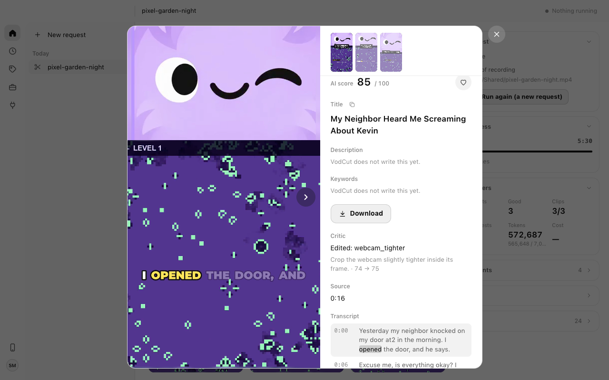

<!-- The source is the Russian README.md; translations: README.<language>.md, the same structure. A change to README.md
     changes README.en.md in the same PR; the other languages follow (each says it was translated automatically from
     the Russian original and links it and Weblate). Pictures: docs/images/. -->
<div align="center">

# SMTV

**Biến một buổi stream dài thành những clip ngắn và một video tóm tắt. Miễn phí, ngay trên máy tính của bạn.**

<!-- languages -->
[Русский](README.md) · [English](README.en.md) · [Қазақша](README.kk.md) · [Oʻzbekcha](README.uz.md) · [Azərbaycanca](README.az.md) · [Кыргызча](README.ky.md) · [简体中文](README.zh-CN.md) · [日本語](README.ja.md) · [한국어](README.ko.md) · **Tiếng Việt** · [Bahasa Indonesia](README.id.md) · [हिन्दी](README.hi.md) · [বাংলা](README.bn.md) · [Español](README.es.md) · [Português](README.pt-BR.md) · [Deutsch](README.de.md)

> 🌐 Trang này được dịch tự động. Hãy giúp cải thiện bản dịch: [Weblate](https://hosted.weblate.org/engage/smtv/) · [pull request](https://github.com/yuriti/clipit/pulls) · [Bản gốc: Русский](README.md).

[](https://github.com/yuriti/clipit/releases/latest)
[](https://pepy.tech/projects/smtv)
[](https://github.com/yuriti/clipit/stargazers)
[](LICENSE)
[](https://pypi.org/project/smtv/)
[](https://hosted.weblate.org/engage/smtv/)


[**Tải SMTV**](#tải-về) · [Hướng dẫn từng bước](docs/guide/vi/README.md) · [So sánh](#so-sánh-smtv-với-các-công-cụ-khác) · [Câu hỏi](#câu-hỏi-thường-gặp)

</div>

---

Bạn vừa stream sáu tiếng. Đâu đó trong đó có mười khoảnh khắc đáng đăng — nhưng muốn tìm ra chúng thì phải xem lại
từ đầu đến cuối. **SMTV xem giúp bạn.** Dán đường link tới bản ghi trên Twitch hoặc YouTube, hoặc chọn một file video,
SMTV sẽ nghe toàn bộ buổi stream, chọn ra những khoảnh khắc hay nhất và trả cho bạn **các clip dọc sẵn sàng để đăng**
lên TikTok, Shorts và Reels, có phụ đề và webcam ở phía trên, cùng với **một video tóm tắt 20–30 phút** của cả buổi
stream cho YouTube.

## SMTV làm được gì

| | |
|---|---|
| 🎬 **Clip sẵn sàng để đăng** | Khung dọc 9:16, phụ đề lớn, một thẻ tiêu đề ngắn ở đầu và webcam của streamer đặt phía trên phần game. |
| ⏱️ **Stream dài cũng không sao** | Đưa vào bản ghi 6–12 tiếng, nhận về tối đa 30 clip. Clip xuất hiện lần lượt: bạn có thể bắt đầu đăng trước khi các clip còn lại xong. |
| 📺 **Video tóm tắt cả buổi stream** | Một video 20–30 phút cho YouTube: chính buổi stream đó, được cắt gọn chỉ còn những phần đáng xem. |
| 🗣️ **Nhiều ngôn ngữ** | Tiếng Nga, 25 ngôn ngữ châu Âu và hàng chục ngôn ngữ khác. SMTV chuyển lời nói thành văn bản ngay trên máy tính của bạn. |
| 🔒 **File của bạn ở lại với bạn** | Clip được làm và lưu trên máy tính của bạn. Không có gì bị tải lên website nào cả. |
| 💸 **Miễn phí và mở** | Giấy phép MIT: cứ dùng, cứ chia sẻ, dùng cho khách hàng cũng được. Không watermark, không giới hạn số phút. |

## Xem SMTV hoạt động

**Dán link hoặc chọn file — rồi theo dõi từng bước.** Mọi bước đều hiện trên màn hình: chuyển lời nói thành văn bản,
tìm khoảnh khắc, chấm điểm, dựng từng clip.


**Clip xuất hiện lần lượt.** Xem ngay trong SMTV, tải về, đăng lên.


**Mỗi clip đều đi kèm văn bản.** Đọc xem đã nói gì và vì sao SMTV chọn khoảnh khắc đó.



**Và một video tóm tắt cả buổi stream** cho YouTube, được làm sau các clip.


**Sáng hoặc tối** — giống như trên máy tính của bạn.


<sub>Buổi stream trong các hình này được dựng riêng cho bản demo: một trò chơi nhỏ, một linh vật hoạt hình thay cho
webcam và giọng máy. Không có người thật nào trên màn hình.</sub>

## Miễn phí và mã nguồn mở

- **SMTV miễn phí.** Toàn bộ chương trình là mã nguồn mở theo [giấy phép MIT](LICENSE): dùng cho bản thân, cho kênh
  của bạn hay cho khách hàng, sửa đổi và chia sẻ đều được.
- **Không watermark, không giới hạn số phút, không cần đăng ký trả phí SMTV.**
- **Bạn chỉ trả tiền cho AI, và chỉ khi bạn muốn.** SMTV cần một AI để đọc văn bản của buổi stream và chọn khoảnh khắc.
  Đó có thể là một AI miễn phí chạy trên chính máy tính của bạn, hoặc một dịch vụ do bạn chọn — xem bên dưới.
- **Dữ liệu của bạn ở lại với bạn.** Clip được làm và lưu trên máy tính của bạn. Chỉ có văn bản của buổi stream được gửi
  tới AI mà bạn chọn. Với AI miễn phí trên máy tính của bạn thì không có gì rời khỏi máy cả.

## Chọn AI: ba cách

SMTV tự chuyển lời nói thành văn bản ngay trên máy tính của bạn. Để chọn ra khoảnh khắc hay nhất, nó hỏi một AI. Hãy
chọn một cách — một cách là đủ, và bạn có thể đổi bất cứ lúc nào trong **Settings → AI** (Cài đặt → AI).

| | Cách làm | Chi phí | Phù hợp với |
|---|---|---|---|
| ⭐ **Qua tài khoản** | Đăng nhập tài khoản StreamMoment (Google, Twitch hoặc Telegram) và nạp tiền vào số dư. Vậy là xong: không cần key, không cần cài đặt gì. | Dùng bao nhiêu trả bấy nhiêu, trừ vào số dư | Tất cả mọi người: cách đơn giản nhất. Cũng cần khi muốn dán **link** tới bản ghi. [Hướng dẫn](docs/guide/vi/account.md) |
| 🔑 **Key của riêng bạn** | Bạn đã dùng OpenAI, Claude, Gemini hoặc OpenRouter? Dán key của bạn vào, SMTV sẽ dùng trực tiếp. | Bạn trả thẳng cho dịch vụ đó; một số có gói miễn phí | Người đã dùng sẵn một dịch vụ AI. [Lấy key ở đâu](docs/guide/vi/get-a-key.md) |
| 💻 **Miễn phí, trên máy tính của bạn** | Cài Ollama hoặc LM Studio và một model Qwen; SMTV tự tìm thấy. | Miễn phí | Máy tính có card đồ họa mạnh. Clip ra kém hơn. [Hướng dẫn](docs/guide/vi/free-ai-on-your-computer.md) |

## Tải về

| Máy tính của bạn | Tải về | Dung lượng |
|---|---|---|
| **Windows 10 hoặc 11** (64-bit) | [**SMTV cho Windows**](https://github.com/yuriti/clipit/releases/latest/download/SMTV-windows.zip) (trình cài đặt) | khoảng 130 MB |
| **Mac** — chip Apple (M1 trở về sau) hoặc Intel, macOS 13+ | [**SMTV cho Mac**](https://github.com/yuriti/clipit/releases/latest/download/SMTV-mac.dmg) | khoảng 270 MB |

Một file cho mọi máy Mac: SMTV tự chạy phiên bản được làm cho bộ xử lý của máy Mac của bạn. Dùng Windows mà không cần cài gì:
[file ZIP](https://github.com/yuriti/clipit/releases/latest/download/SMTV-windows.zip) — giải nén và mở
**SMTV.exe**.

Mọi thứ SMTV cần đều có sẵn bên trong: chương trình, Python và ffmpeg có hỗ trợ phụ đề. Phần nhận dạng giọng nói được tải về
ở lần mở đầu tiên, chỉ cho ngôn ngữ của bạn (0.9–2.5 GB, một lần duy nhất): SMTV đề nghị việc này chỉ bằng một nút, **Fix** (Sửa).

**Lần đầu, hệ thống sẽ cảnh báo bạn.** SMTV chưa có chữ ký số: chữ ký cho Windows sẽ có muộn hơn một chút, chữ ký cho
macOS sẽ có sớm nhất có thể, và khi đó cảnh báo này sẽ biến mất. Cho đến lúc đó:

- **Windows** («Windows đã bảo vệ PC của bạn»): **Thông tin thêm** (More info) → **Vẫn chạy** (Run anyway).
- **Mac**: mở SMTV một lần, rồi vào **Cài đặt hệ thống → Quyền riêng tư & Bảo mật** (System Settings → Privacy & Security)
  → **Vẫn mở** (Open Anyway).
- **Windows 11 có bật Smart App Control** chặn hoàn toàn các chương trình không có chữ ký, và không có nút nào để cho qua.
  Hãy dùng cách cài bằng một dòng lệnh bên dưới: nó chạy được ngay cả khi Smart App Control đang bật. Khi SMTV có chữ ký,
  bản tải về cũng sẽ chạy được ở đó.

[Từng bước, có hình minh họa](docs/guide/vi/install.md).

### Dành cho người dùng có kinh nghiệm: một dòng lệnh trong terminal

Vẫn là SMTV đó, được cài bằng [uv](https://astral.sh/uv) vào thư mục người dùng của bạn. Cách này cũng chạy được trên
**Linux** và khi bật **Smart App Control**, và cũng cập nhật từ cửa sổ như vậy.

**Windows** — bấm Start, gõ **PowerShell**, mở nó lên và dán:

```powershell
powershell -ExecutionPolicy ByPass -c "irm https://raw.githubusercontent.com/yuriti/clipit/main/install/install.ps1 | iex"
```

**Mac hoặc Linux** — mở **Terminal** và dán:

```bash
curl -LsSf https://raw.githubusercontent.com/yuriti/clipit/main/install/install.sh | sh
```

Bấm Enter và chờ vài phút. Không cần mật khẩu quản trị viên. Biểu tượng **SMTV** sẽ xuất hiện — trên desktop và trong
menu Start trên Windows, trong Applications trên Mac, trong menu ứng dụng trên Linux.

## Clip đầu tiên trong ba bước

1. **Chọn AI** — lần đầu, cửa sổ sẽ hiện ba cách ([chọn cách nào?](docs/guide/vi/connect-ai.md)).
2. **Dán link** tới bản ghi trên Twitch hoặc YouTube, hoặc chọn một file video trên máy tính.
3. **Chờ.** Clip xuất hiện lần lượt: xem, tải về, đăng lên.

Lần đầu, SMTV kiểm tra máy tính của bạn và đề nghị sửa những gì còn thiếu chỉ bằng một nút, **Fix** (Sửa).
[Clip đầu tiên, từng bước một](docs/guide/vi/first-clip.md).

## Hướng dẫn từng bước

Dành cho những ai mới làm quen với tất cả những thứ này — từng bước, có hình minh họa:

| | |
|---|---|
| [Cài đặt trên Windows, Mac hoặc Linux](docs/guide/vi/install.md) | và phải làm gì khi hệ thống cảnh báo |
| [Clip đầu tiên của bạn](docs/guide/vi/first-clip.md) | từ một link hoặc một file đến một clip hoàn chỉnh |
| [Chọn AI nào](docs/guide/vi/connect-ai.md) | ba cách, đặt cạnh nhau |
| [AI miễn phí trên máy tính của bạn](docs/guide/vi/free-ai-on-your-computer.md) | Ollama hoặc LM Studio với Qwen: model nào hợp với card đồ họa của bạn |
| [Lấy key ở đâu](docs/guide/vi/get-a-key.md) | dịch vụ nào có gói miễn phí hoặc rẻ, từng bước một |
| [Tài khoản StreamMoment](docs/guide/vi/account.md) | đăng nhập, số dư |
| [SMTV trên điện thoại](docs/guide/vi/phone.md) | quét mã QR và xem clip trên điện thoại |
| [Lời nói và ngôn ngữ](docs/guide/vi/speech-and-languages.md) | SMTV hiểu những ngôn ngữ nào |
| [Cập nhật và gỡ cài đặt](docs/guide/vi/update-and-remove.md) | |
| [Có lỗi xảy ra](docs/guide/vi/troubleshooting.md) | kiểm tra máy tính, **Fix**, **Report a problem** (Báo cáo sự cố) |

## So sánh SMTV với các công cụ khác

Những công cụ cắt clip mã nguồn mở được dùng nhiều nhất, theo chính mã nguồn và tài liệu của từng dự án, **tính đến
tháng 11 năm 2026**. Đó đều là những dự án tốt, mỗi dự án làm cho một việc riêng; bảng này chỉ
cho thấy SMTV khác ở đâu. Có gì thay đổi? [Hãy báo cho chúng tôi](https://github.com/yuriti/clipit/issues/new?template=bug.yml)
và chúng tôi sẽ sửa bảng.

| | **SMTV** | [openshorts](https://github.com/mutonby/openshorts) | [SupoClip](https://github.com/FujiwaraChoki/supoclip) | [PeakCut](https://github.com/haziqahmedqasmi/PeakCut) | [FunClip](https://github.com/modelscope/FunClip) |
|---|---|---|---|---|---|
| Giấy phép | **MIT** | MIT (thư mục `cloud/` có giấy phép riêng) | Giấy phép mã nguồn phi thương mại | MIT | MIT |
| Cả buổi stream 6–12 tiếng | **Có** | Mặc định 60 phút mỗi lần xử lý | Mặc định 90 phút | Không nêu giới hạn độ dài | Không làm cho stream |
| Video tóm tắt dài của cả buổi stream | **Có, 20–30 phút** | Không | Không («recap» của nó là một clip ngắn) | Không | Không |
| Lời nói tiếng Nga | **GigaAM-v3, làm riêng cho tiếng Nga** | Whisper hoặc Parakeet v3 | AssemblyAI hoặc Whisper | Không (Parakeet v2, chỉ tiếng Anh) | Không (tiếng Trung và tiếng Anh) |
| Webcam của streamer trong khung dọc | **Có** | Không | Chế độ gaming, mặc định tắt | Có | Không có clip dọc |
| Chuyển lời nói thành văn bản theo mặc định | **Trên máy tính của bạn, miễn phí** | Trên máy tính của bạn | AssemblyAI, dịch vụ trả phí | Trên máy tính của bạn | Trên máy tính của bạn |
| Cách khởi động | **Cửa sổ và biểu tượng riêng: tải về cho Windows và Mac, hoặc một dòng lệnh** | Trang web trong Docker | Trang web trong Docker | Trang web | Trang web |

## Câu hỏi thường gặp

<details>
<summary><b>Có thật sự miễn phí không?</b></summary>

Có. Bản thân SMTV không tốn đồng nào và không có giới hạn. Khoản chi duy nhất có thể có là AI chọn khoảnh khắc: miễn phí
nếu chạy trên máy tính của bạn, hoặc trả cho dịch vụ bạn chọn (qua tài khoản StreamMoment hoặc key của riêng bạn).
</details>

<details>
<summary><b>Tôi có cần máy tính mạnh không?</b></summary>

Không cần card đồ họa: SMTV chạy được trên máy tính bình thường, chỉ chậm hơn. Card NVIDIA giúp chuyển lời nói thành văn
bản nhanh hơn. Ngoại lệ là AI miễn phí trên máy tính của bạn — nó cần card đồ họa mạnh
([loại nào](docs/guide/vi/free-ai-on-your-computer.md)). Dung lượng ổ đĩa trống: ít nhất 5 GB, 20 GB cho một buổi stream 6 tiếng.
</details>

<details>
<summary><b>Mất bao lâu?</b></summary>

Đo trên máy Mac dùng chip Apple, không có card đồ họa: một bản ghi Twitch dài 2.35 tiếng mất khoảng 6 phút để tìm
khoảnh khắc, sau đó khoảng 1 phút cho mỗi clip; một video tóm tắt 10.7 phút mất 6.5 phút. Trước khi một yêu cầu bắt
đầu, SMTV cho biết nó sẽ mất khoảng bao lâu.
</details>

<details>
<summary><b>Chạy được trên hệ điều hành nào?</b></summary>

Windows 10 (phiên bản 1809) trở lên, 64-bit; macOS 13 trở lên trên máy Mac chip Apple và chip Intel (trên chip Apple, SMTV chạy trực tiếp từ macOS 14; trên macOS 13 nó chạy phiên bản Intel của mình qua Rosetta, chậm hơn); Linux (cài bằng một dòng lệnh). Đã kiểm tra trên Windows 11 và trên máy Mac chip Apple; máy Mac chip Intel (chỉ chạy
qua Rosetta) và Linux desktop chưa được thử.
</details>

<details>
<summary><b>SMTV hiểu những ngôn ngữ nào?</b></summary>

Tiếng Nga, 25 ngôn ngữ châu Âu và hàng chục ngôn ngữ khác. SMTV tự nhận ra ngôn ngữ của buổi stream.
[Chi tiết](docs/guide/vi/speech-and-languages.md).
</details>

<details>
<summary><b>Tôi có thể dùng clip cho khách hàng không?</b></summary>

Được. Giấy phép MIT cho phép mọi mục đích sử dụng, kể cả thương mại: cắt clip cho streamer, cho agency, cho kênh của
chính bạn. Hãy tôn trọng quyền của streamer có buổi stream mà bạn cắt clip.
</details>

<details>
<summary><b>Clip của tôi được lưu ở đâu? Có gì bị tải lên không?</b></summary>

Clip ở lại trên máy tính của bạn. File video của riêng bạn không bao giờ rời khỏi máy. Link thì được tải qua tài khoản
StreamMoment: máy chủ của nó chuyển bản ghi cho SMTV theo từng phần và không lưu gì cả. Văn bản của buổi stream chỉ được
gửi tới AI mà bạn chọn. Key của các dịch vụ AI ở lại trên máy tính của bạn và không bao giờ xuất hiện trong log hay
báo cáo sự cố.
</details>

<details>
<summary><b>SMTV có tự đăng lên TikTok hoặc YouTube không?</b></summary>

Chưa: bạn tải clip về và tự đăng. Settings → About → «Coming» (Cài đặt → Giới thiệu → Sắp có) cho biết những gì đang
được lên kế hoạch.
</details>

<details>
<summary><b>Có gì đó không chạy.</b></summary>

Settings → **Computer check** → **Fix** (Cài đặt → Kiểm tra máy tính → Sửa) giải quyết được phần lớn vấn đề. Vẫn chưa
được? Settings → Computer check → **Report…** (Báo cáo…): SMTV chuẩn bị một bản báo cáo không chứa key của bạn và mở một
trang trên GitHub; không có gì được tự động gửi đi.
[Nên thử gì](docs/guide/vi/troubleshooting.md).
</details>

## Giúp dịch SMTV

Cửa sổ SMTV nói theo ngôn ngữ của máy tính bạn. Các bản dịch do mọi người làm trên
[Weblate](https://hosted.weblate.org/engage/smtv/) — không cần biết lập trình: mở trang, chọn ngôn ngữ của bạn, dịch
vài dòng. Các bản dịch của trang này được làm tự động; nếu bạn thấy lỗi, hãy sửa nó bằng một pull request.
[Cách việc dịch hoạt động](docs/translations.md).

[](https://hosted.weblate.org/engage/smtv/)

## StreamMoment

SMTV được làm bởi đội ngũ [StreamMoment](https://streammoment.tv). Tài khoản StreamMoment là cách đơn giản nhất để cho
SMTV một AI và để dán link tới bản ghi; không có nó SMTV vẫn chạy.

- [Báo cáo sự cố](https://github.com/yuriti/clipit/issues/new?template=bug.yml) · [Đề xuất ý tưởng](https://github.com/yuriti/clipit/issues/new?template=feature.yml)
- [Dành cho người dùng nâng cao](docs/advanced.md): Docker, mọi dịch vụ AI, model nhận dạng giọng nói, key, lệnh
- [Thay đổi](CHANGELOG.md) · [Đóng góp](CONTRIBUTING.md) · [Bảo mật](SECURITY.md)
- Thích SMTV? [Ủng hộ trên Boosty](https://boosty.to/smtv) và tặng repository một ⭐ — điều đó giúp người khác tìm thấy nó.

Giấy phép: [MIT](LICENSE).
