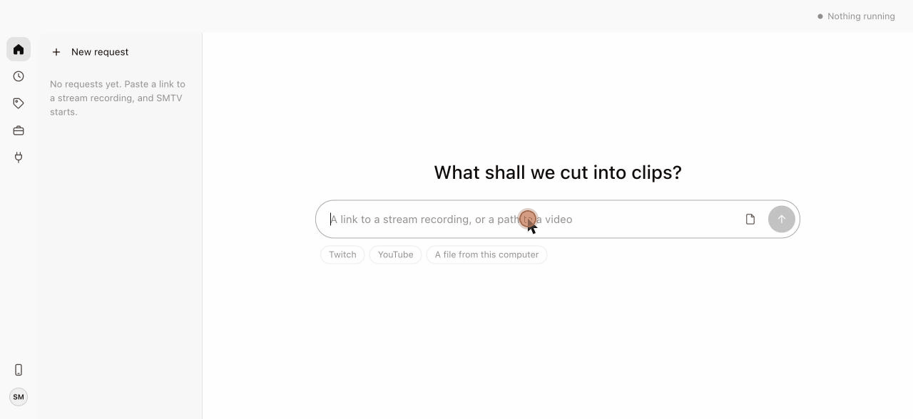

<!-- The source is the Russian README.md; translations: README.<language>.md, the same structure. A change to README.md
     changes README.en.md in the same PR; the other languages follow (each says it was translated automatically from
     the Russian original and links it and Weblate). Pictures: docs/images/. -->
<div align="center">

# SMTV

**把一场长直播变成短视频切片和回顾视频。免费，在你自己的电脑上完成。**

<!-- languages -->
[Русский](README.md) · [English](README.en.md) · [Қазақша](README.kk.md) · [Oʻzbekcha](README.uz.md) · [Azərbaycanca](README.az.md) · [Кыргызча](README.ky.md) · **简体中文** · [日本語](README.ja.md) · [한국어](README.ko.md) · [Tiếng Việt](README.vi.md) · [Bahasa Indonesia](README.id.md) · [हिन्दी](README.hi.md) · [বাংলা](README.bn.md) · [Español](README.es.md) · [Português](README.pt-BR.md) · [Deutsch](README.de.md)

> 🌐 本页面由机器自动翻译。欢迎帮助改进：[Weblate](https://hosted.weblate.org/engage/smtv/) · [pull request](https://github.com/yuriti/clipit/pulls) · [原文: Русский](README.md)。

[](https://github.com/yuriti/clipit/releases/latest)
[](https://pepy.tech/projects/smtv)
[](https://github.com/yuriti/clipit/stargazers)
[](LICENSE)
[](https://pypi.org/project/smtv/)
[](https://hosted.weblate.org/engage/smtv/)


[**下载 SMTV**](#下载) · [分步指南](docs/guide/zh-CN/README.md) · [与其他工具对比](#smtv-与其他工具对比) · [常见问题](#常见问题)

</div>

---

你播了六个小时。其中藏着十个值得发出去的时刻——可要找到它们，就得把整场再看一遍。**SMTV 替你看。**
粘贴一个 Twitch 或 YouTube 录像链接，或者选一个视频文件，SMTV 会听完整场直播，挑出最精彩的时刻，给你
**可以直接发布的竖屏切片**，适用于 TikTok、Shorts 和 Reels，带字幕，摄像头画面放在上方；另外还有一段整场直播的
**20–30 分钟回顾视频**，可以发到 YouTube。

## 它能做什么

| | |
|---|---|
| 🎬 **切片直接就能发** | 竖屏 9:16，大字幕，开头有一张简短的标题卡，主播的摄像头画面放在游戏画面上方。 |
| ⏱️ **长直播也没问题** | 放进 6–12 小时的录像，最多产出 30 个切片。切片一个接一个出现：不用等全部做完就能开始发。 |
| 📺 **整场直播的回顾** | 一段 20–30 分钟的 YouTube 视频：就是这场直播本身，只剪留值得看的部分。 |
| 🗣️ **支持多种语言** | 俄语、25 种欧洲语言以及其他几十种语言。SMTV 直接在你的电脑上把语音转成文字。 |
| 🔒 **文件留在你手里** | 切片在你的电脑上制作和保存。不会上传到任何网站。 |
| 💸 **免费且开放** | MIT 许可证：随便用、随便分享，也可以给客户用。没有水印，没有时长限制。 |

## 看看它怎么工作

**粘贴链接或选择文件——然后看着每一步进行。** 每一步都显示在屏幕上：语音转文字、寻找时刻、
给时刻打分、剪辑每个切片。



**切片一个接一个出现。** 直接在 SMTV 里观看、下载、发布。


**每个切片都附带文字。** 看看说了什么，以及 SMTV 为什么选了这个时刻。


**还有整场直播的回顾视频**，用于 YouTube，在切片之后生成。


**浅色或深色**——跟随你的电脑。


<sub>这些图片里的直播是为演示虚构的：一个小游戏、一个卡通吉祥物代替摄像头画面，还有电脑合成的声音。画面中没有真人。</sub>

## 免费且开源

- **SMTV 是免费的。** 整个程序基于 [MIT 许可证](LICENSE)开源：可以自己用、给你的频道用、给客户用，
  也可以修改和分享。
- **没有水印，没有时长限制，SMTV 不需要订阅。**
- **你只需为 AI 付费，而且只有你愿意时才需要。** SMTV 需要一个 AI 来阅读直播的文字并挑选时刻。
  它可以是你电脑上的免费 AI，也可以是你自己选的服务——见下文。
- **你的数据留在你手里。** 切片在你的电脑上制作和保存。只有直播的文字会发送给你选择的 AI。
  如果用的是你电脑上的免费 AI，什么都不会离开你的电脑。

## 选择你的 AI：三种方式

SMTV 会自己在你的电脑上把语音转成文字。挑选最佳时刻时，它会去问一个 AI。选一种方式就够了，
之后随时可以在 **Settings → AI**（设置 → AI）里更换。

| | 怎么做 | 费用 | 适合谁 |
|---|---|---|---|
| ⭐ **通过账户** | 登录 StreamMoment 账户（Google、Twitch 或 Telegram）并充值余额。就这样：不需要密钥，不需要设置。 | 从余额中按用量扣费 | 所有人：最简单的方式。粘贴录像**链接**也需要它。[指南](docs/guide/zh-CN/account.md) |
| 🔑 **你自己的密钥** | 已经在用 OpenAI、Claude、Gemini 或 OpenRouter？粘贴你的密钥，SMTV 直接使用它。 | 直接付给该服务；有些有免费套餐 | 已经在用某个 AI 服务的人。[去哪里获取密钥](docs/guide/zh-CN/get-a-key.md) |
| 💻 **免费，在你的电脑上** | 安装 Ollama 或 LM Studio 以及一个 Qwen 模型；SMTV 会自己找到它。 | 免费 | 显卡性能强的电脑。切片效果会差一些。[指南](docs/guide/zh-CN/free-ai-on-your-computer.md) |

## 下载

| 你的电脑 | 下载 | 大小 |
|---|---|---|
| **Windows 10 或 11**（64 位） | [**Windows 版 SMTV**](https://github.com/yuriti/clipit/releases/latest/download/SMTV-windows-setup.exe)（安装程序） | 约 130 MB |
| **Mac** — Apple 芯片（M1 及更新）或 Intel，macOS 13+ | [**Mac 版 SMTV**](https://github.com/yuriti/clipit/releases/latest/download/SMTV-mac.dmg) | 约 270 MB |

所有 Mac 都用同一个文件：SMTV 会自动启动为你的 Mac 处理器制作的版本。在 Windows 上不想安装任何东西：下载
[ZIP 压缩包](https://github.com/yuriti/clipit/releases/latest/download/SMTV-windows.zip)——解压后打开
**SMTV.exe**。

SMTV 需要的一切都在里面：程序本身、Python，以及能加字幕的 ffmpeg。语音识别会在第一次启动时下载，而且只下载你的语言
（0.9–2.5 GB，只需一次）：SMTV 会提供一个按钮 **Fix**（修复），一键完成。

**第一次打开时，系统会发出警告。** SMTV 还没有数字签名：Windows 的签名稍晚一些就会有，macOS 的签名会尽快有，
之后这个警告就会消失。在那之前：

- **Windows**（“Windows 已保护你的电脑”）：点 **更多信息**（More info）→ **仍要运行**（Run anyway）。
- **Mac**：先打开一次 SMTV，然后打开 **系统设置 → 隐私与安全性**（System Settings → Privacy & Security）→ **仍要打开**（Open Anyway）。
- **开启了智能应用控制（Smart App Control）的 Windows 11** 会完全阻止没有签名的程序，而且没有放行的按钮。
  请用下面的一行命令安装：开着 Smart App Control 也能用。等 SMTV 有了签名，下载版在那里也能用。

[每一步都配图的说明](docs/guide/zh-CN/install.md)。

### 给有经验的用户：在终端里用一行命令

同一个 SMTV，用 [uv](https://astral.sh/uv) 装进你的用户文件夹。它也能在 **Linux** 上使用，开着 **Smart App Control** 也能用，
同样从窗口里更新。

**Windows**——点击“开始”，输入 **PowerShell**，打开它并粘贴：

```powershell
powershell -ExecutionPolicy ByPass -c "irm https://raw.githubusercontent.com/yuriti/clipit/main/install/install.ps1 | iex"
```

**Mac 或 Linux**——打开 **Terminal**（终端）并粘贴：

```bash
curl -LsSf https://raw.githubusercontent.com/yuriti/clipit/main/install/install.sh | sh
```

按 Enter，等几分钟。不需要管理员密码。随后会出现 **SMTV** 图标——Windows 上在桌面和“开始”菜单里，
Mac 上在“应用程序”里，Linux 上在应用程序菜单里。

## 三步做出你的第一个切片

1. **选择一个 AI**——第一次打开时，窗口会显示三种方式（[选哪个？](docs/guide/zh-CN/connect-ai.md)）。
2. **粘贴链接**（Twitch 或 YouTube 录像），或从电脑里选一个视频文件。
3. **等待。** 切片一个接一个出现：观看、下载、发布。

第一次使用时，SMTV 会检查你的电脑，缺什么就提供一个按钮 **Fix**（修复）一键补上。
[第一个切片，分步说明](docs/guide/zh-CN/first-clip.md)。

## 分步指南

写给第一次接触这些的人——每一步都有，还配图：

| | |
|---|---|
| [在 Windows、Mac 或 Linux 上安装](docs/guide/zh-CN/install.md) | 以及系统发出警告时该怎么办 |
| [你的第一个切片](docs/guide/zh-CN/first-clip.md) | 从链接或文件到做好的切片 |
| [选哪个 AI](docs/guide/zh-CN/connect-ai.md) | 三种方式并排对比 |
| [你电脑上的免费 AI](docs/guide/zh-CN/free-ai-on-your-computer.md) | Ollama 或 LM Studio 搭配 Qwen：哪个模型适合你的显卡 |
| [去哪里获取密钥](docs/guide/zh-CN/get-a-key.md) | 哪些服务有免费或便宜的套餐，分步说明 |
| [StreamMoment 账户](docs/guide/zh-CN/account.md) | 登录、余额 |
| [在手机上用 SMTV](docs/guide/zh-CN/phone.md) | 扫描二维码，在手机上看切片 |
| [语音与语言](docs/guide/zh-CN/speech-and-languages.md) | SMTV 能听懂哪些语言 |
| [更新和卸载](docs/guide/zh-CN/update-and-remove.md) | |
| [出问题了](docs/guide/zh-CN/troubleshooting.md) | 电脑检查、**Fix**、**Report a problem** |

## SMTV 与其他工具对比

最常用的开源切片工具，信息来自各项目自己的代码和文档，**截至 2026 年 11 月**。
它们都是好项目，各有各的用途；这张表只展示 SMTV 的不同之处。有什么变化了？
[告诉我们](https://github.com/yuriti/clipit/issues/new?template=bug.yml)，我们会更新表格。

| | **SMTV** | [openshorts](https://github.com/mutonby/openshorts) | [SupoClip](https://github.com/FujiwaraChoki/supoclip) | [PeakCut](https://github.com/haziqahmedqasmi/PeakCut) | [FunClip](https://github.com/modelscope/FunClip) |
|---|---|---|---|---|---|
| 许可证 | **MIT** | MIT（`cloud/` 文件夹有自己的许可证） | 非商业源码许可证 | MIT | MIT |
| 一整场 6–12 小时的直播 | **可以** | 默认每个任务 60 分钟 | 默认 90 分钟 | 未说明时长限制 | 不是为直播设计的 |
| 整场直播的长回顾视频 | **有，20–30 分钟** | 没有 | 没有（它的“recap”是一个短切片） | 没有 | 没有 |
| 俄语语音 | **GigaAM-v3，专为俄语打造** | Whisper 或 Parakeet v3 | AssemblyAI 或 Whisper | 不支持（Parakeet v2，仅英语） | 不支持（中文和英语） |
| 竖屏画面里有主播摄像头 | **有** | 没有 | 游戏模式，默认关闭 | 有 | 不做竖屏切片 |
| 默认的语音转文字 | **在你的电脑上，免费** | 在你的电脑上 | AssemblyAI，付费服务 | 在你的电脑上 | 在你的电脑上 |
| 启动方式 | **独立窗口和图标：Windows 和 Mac 直接下载，或一行命令安装** | Docker 中的网页 | Docker 中的网页 | 网页 | 网页 |

## 常见问题

<details>
<summary><b>真的免费吗？</b></summary>

是的。SMTV 本身不花钱，也没有任何限制。唯一可能的费用是挑选时刻的 AI：用你电脑上的 AI 就是免费的，
或者付费给你选择的服务（通过 StreamMoment 账户或你自己的密钥）。
</details>

<details>
<summary><b>需要很强的电脑吗？</b></summary>

不需要显卡：SMTV 在普通电脑上也能运行，只是慢一些。NVIDIA 显卡能让语音转文字更快。
电脑上的免费 AI 是例外——它需要性能强的显卡（[哪种显卡](docs/guide/zh-CN/free-ai-on-your-computer.md)）。
可用磁盘空间：至少 5 GB，6 小时的直播需要 20 GB。
</details>

<details>
<summary><b>需要多长时间？</b></summary>

在一台 Apple 芯片的 Mac 上实测，没有独立显卡：一段 2.35 小时的 Twitch 录像，找时刻花了大约 6 分钟，
之后每个切片大约 1 分钟；一段 10.7 分钟的回顾视频花了 6.5 分钟。任务开始前，SMTV 会显示预计需要多久。
</details>

<details>
<summary><b>能在哪些系统上运行？</b></summary>

Windows 10（1809 版）或更新版本，64 位；Apple 芯片和 Intel 芯片的 Mac 需要 macOS 13 或更新版本（在 Apple 芯片上，SMTV 从 macOS 14 起原生运行；在 macOS 13 上它通过 Rosetta 运行自己的 Intel 版本，速度较慢）；
Linux（一行命令安装）。已在 Windows 11 和 Apple 芯片的 Mac 上验证；Intel 芯片的 Mac（只通过 Rosetta 运行）和 Linux 桌面还没有测试。
</details>

<details>
<summary><b>能听懂哪些语言？</b></summary>

俄语、25 种欧洲语言以及其他几十种语言。SMTV 会自己识别直播的语言。
[详情](docs/guide/zh-CN/speech-and-languages.md)。
</details>

<details>
<summary><b>可以把切片用在客户的项目上吗？</b></summary>

可以。MIT 许可证允许任何用途，包括商业用途：为主播做切片、为机构做、为你自己的频道做。
请尊重你所剪辑直播的主播的权利。
</details>

<details>
<summary><b>我的切片去哪儿了？会上传什么吗？</b></summary>

切片留在你的电脑上。你自己的视频文件永远不会离开电脑。链接是通过 StreamMoment 账户获取的：
它的服务器把录像分段传给 SMTV，什么也不保存。直播的文字只发送给你选择的 AI。
AI 服务的密钥留在你的电脑上，永远不会出现在日志或问题报告里。
</details>

<details>
<summary><b>它会自己发布到 TikTok 或 YouTube 吗？</b></summary>

暂时还不会：你需要下载切片，自己发布。Settings → About → «Coming»（设置 → 关于 → 即将推出）里能看到计划中的功能。
</details>

<details>
<summary><b>有东西不能用。</b></summary>

Settings → **Computer check** → **Fix**（设置 → 电脑检查 → 修复）能解决大多数问题。还是不行？
Settings → Computer check → **Report…**：SMTV 会准备一份不含你密钥的报告，并打开 GitHub 上的一个页面；
不会自动发送任何东西。[可以试试这些](docs/guide/zh-CN/troubleshooting.md)。
</details>

## 帮助翻译 SMTV

SMTV 的窗口会使用你电脑的语言。翻译由大家在 [Weblate](https://hosted.weblate.org/engage/smtv/) 上完成——
不需要会编程：打开页面，选择你的语言，翻译几行就行。本页面的各语言版本是自动翻译的；如果发现错误，
欢迎通过 pull request 修正。[翻译是怎么运作的](docs/translations.md)。

[](https://hosted.weblate.org/engage/smtv/)

## StreamMoment

SMTV 由 [StreamMoment](https://streammoment.tv) 团队开发。StreamMoment 账户是给 SMTV 接入 AI、
粘贴录像链接的最简单方式；没有它，SMTV 也能用。

- [报告问题](https://github.com/yuriti/clipit/issues/new?template=bug.yml) · [提出建议](https://github.com/yuriti/clipit/issues/new?template=feature.yml)
- [给高级用户](docs/advanced.md)：Docker、所有 AI 服务、语音模型、密钥、命令
- [更新日志](CHANGELOG.md) · [参与贡献](CONTRIBUTING.md) · [安全](SECURITY.md)
- 喜欢 SMTV？[在 Boosty 上支持它](https://boosty.to/smtv)，并给仓库点个 ⭐——这能帮助更多人找到它。

许可证：[MIT](LICENSE)。
