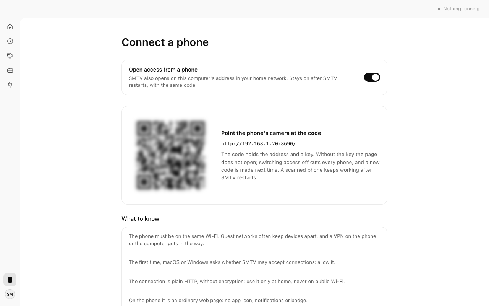

<!-- languages -->
[English](../phone.md) · [Русский](../ru/phone.md) · [Қазақша](../kk/phone.md) · [Oʻzbekcha](../uz/phone.md) · [Azərbaycanca](../az/phone.md) · [Кыргызча](../ky/phone.md) · [简体中文](../zh-CN/phone.md) · **日本語** · [한국어](../ko/phone.md) · [Tiếng Việt](../vi/phone.md) · [Bahasa Indonesia](../id/phone.md) · [हिन्दी](../hi/phone.md) · [বাংলা](../bn/phone.md) · [Español](../es/phone.md) · [Português](../pt-BR/phone.md) · [Deutsch](../de/phone.md)

> 🌐 このページは自動翻訳されています。改善にご協力ください：[Weblate](https://hosted.weblate.org/engage/smtv/) · [プルリクエスト](https://github.com/streammomenttv/smtv/pulls)。

# スマホで SMTV

SMTV をパソコンで動かしたまま、スマホでクリップを見たり、リクエストを始めたり、作業を見守ったりできます。スマホには何もインストール不要です：
ブラウザで開きます。

1. SMTV で、左下の**スマホ**（**phone**）ボタンを押します。
2. **Open access from a phone**（スマホからのアクセスを開く）をオンにします。
3. ネットワークが複数ある？**Address in the network**（ネットワーク上のアドレス）で、スマホがつながっている Wi-Fi のものを選びます。
4. スマホのカメラを **QR コード**に向け、リンクを開きます。

## 知っておくこと

- スマホはパソコンと**同じ Wi-Fi** につないでください。ゲストネットワークでは端末どうしが分けられていることが多く、
  スマホやパソコンの VPN も邪魔になります。
- 初回、macOS や Windows が SMTV の接続受け入れを許可するか尋ねてきます：**許可**してください。
- 接続は暗号化されていない普通のものです：**自宅だけ**で使い、公共の Wi-Fi では絶対に使わないでください。
- コードには鍵が含まれていて、それがないとページは開きません。アクセスをオフにするとすべてのスマホが切断され、次回は新しいコードが作られます。
- スマホを使っている間、パソコンはつけたままにしておく必要があります。
