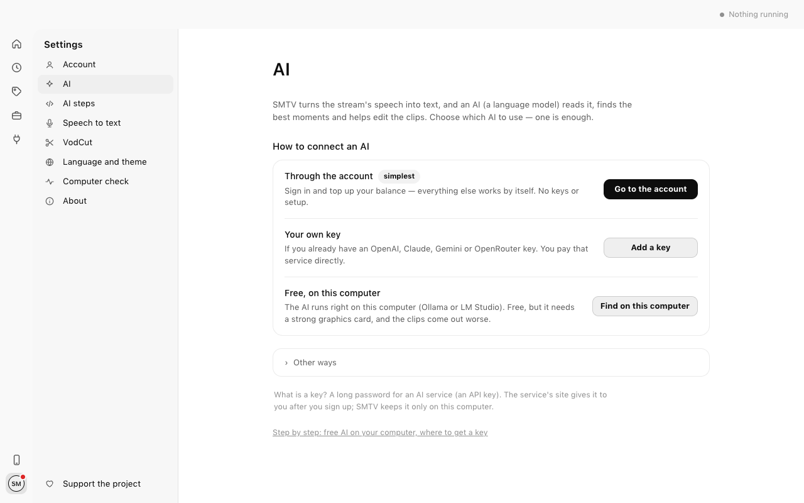

<!-- languages -->
[Русский](../connect-ai.md) · [English](../en/connect-ai.md) · [Қазақша](../kk/connect-ai.md) · [Oʻzbekcha](../uz/connect-ai.md) · [Azərbaycanca](../az/connect-ai.md) · [Кыргызча](../ky/connect-ai.md) · [简体中文](../zh-CN/connect-ai.md) · [日本語](../ja/connect-ai.md) · [한국어](../ko/connect-ai.md) · **Tiếng Việt** · [Bahasa Indonesia](../id/connect-ai.md) · [हिन्दी](../hi/connect-ai.md) · [বাংলা](../bn/connect-ai.md) · [Español](../es/connect-ai.md) · [Português](../pt-BR/connect-ai.md) · [Deutsch](../de/connect-ai.md)

> 🌐 Trang này được dịch tự động. Hãy giúp cải thiện bản dịch: [Weblate](https://hosted.weblate.org/engage/smtv/) · [pull request](https://github.com/streammomenttv/smtv/pulls) · [Bản gốc: Русский](../connect-ai.md).

# Chọn AI nào

SMTV tự chuyển lời nói thành văn bản, ngay trên máy tính của bạn. Để chọn ra khoảnh khắc hay nhất, nó hỏi một AI (một
mô hình ngôn ngữ, giống như mô hình đứng sau ChatGPT). Hãy chọn **một** trong ba cách ở **Settings → AI** (Cài đặt → AI).
Bạn có thể đổi bất cứ lúc nào.

| | ⭐ Qua tài khoản | 🔑 Key của riêng bạn | 💻 Miễn phí, trên máy tính của bạn |
|---|---|---|---|
| Bạn cần làm gì | Đăng nhập, nạp tiền vào số dư | Lấy key trên trang của dịch vụ, dán vào | Cài Ollama hoặc LM Studio và một model |
| Chi phí | Dùng bao nhiêu trả bấy nhiêu, trừ vào số dư | Theo giá của dịch vụ; một số có gói miễn phí | Miễn phí |
| Chất lượng clip | Tốt nhất (các model đám mây mạnh) | Tốt tùy theo model bạn chọn | Kém hơn |
| Máy tính | Máy nào cũng được | Máy nào cũng được | Card đồ họa mạnh: 8–16 GB bộ nhớ video |
| Link tới Twitch và YouTube | Có | Chỉ khi có thêm tài khoản (hoặc dùng file) | Chỉ khi có thêm tài khoản (hoặc dùng file) |
| Hướng dẫn | [Tài khoản](account.md) | [Lấy key ở đâu](get-a-key.md) | [AI miễn phí trên máy tính của bạn](free-ai-on-your-computer.md) |

**Chưa chắc?** Chọn tài khoản: không phải cài đặt gì. Không muốn tốn tiền và có PC chơi game? Hãy thử cách miễn phí
trước. Đã trả tiền cho OpenAI, Claude hoặc Gemini? Dùng key của bạn.

**Key là gì?** Là một mật khẩu dài dành cho dịch vụ AI (một «API key»). Trang của dịch vụ sẽ cấp cho bạn sau khi bạn
đăng ký. SMTV chỉ giữ nó trên máy tính của bạn và chỉ gửi nó tới đúng dịch vụ đó.

**Buổi stream của tôi đi đâu?** Video ở lại trên máy tính của bạn. Chỉ có văn bản của buổi stream được gửi tới AI mà bạn
chọn. Với AI miễn phí trên máy tính của bạn thì không có gì rời khỏi máy.

**Các cách khác.** Trong mục **Other ways** (Các cách khác), SMTV cũng có thể dùng gói đăng ký ChatGPT (Codex) hoặc
Claude (Claude Code). Chúng tôi không khuyến khích: quy định của các dịch vụ này có thể cấm chương trình khác dùng gói
đăng ký.
