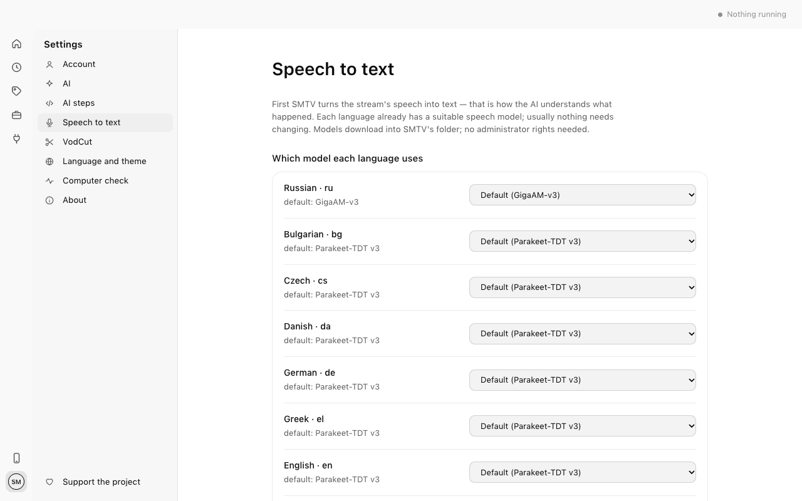

<!-- languages -->
[English](../speech-and-languages.md) · [Русский](../ru/speech-and-languages.md) · [Қазақша](../kk/speech-and-languages.md) · [Oʻzbekcha](../uz/speech-and-languages.md) · [Azərbaycanca](../az/speech-and-languages.md) · [Кыргызча](../ky/speech-and-languages.md) · [简体中文](../zh-CN/speech-and-languages.md) · [日本語](../ja/speech-and-languages.md) · [한국어](../ko/speech-and-languages.md) · **Tiếng Việt** · [Bahasa Indonesia](../id/speech-and-languages.md) · [हिन्दी](../hi/speech-and-languages.md) · [বাংলা](../bn/speech-and-languages.md) · [Español](../es/speech-and-languages.md) · [Português](../pt-BR/speech-and-languages.md) · [Deutsch](../de/speech-and-languages.md)

> 🌐 Trang này được dịch tự động. Hãy giúp cải thiện bản dịch: [Weblate](https://hosted.weblate.org/engage/smtv/) · [pull request](https://github.com/streammomenttv/smtv/pulls).

# Lời nói và ngôn ngữ

Đầu tiên SMTV chuyển lời nói trong buổi stream thành văn bản, kèm thời điểm của từng từ — nhờ đó AI hiểu được chuyện gì
đã xảy ra. Việc này chạy **trên máy tính của bạn, miễn phí**. SMTV tự nhận ra ngôn ngữ của buổi stream.

| Ngôn ngữ | Model | Dung lượng tải (một lần) | Tốc độ trên bộ xử lý 12 nhân |
|---|---|---|---|
| Tiếng Nga | GigaAM-v3, làm riêng cho tiếng Nga | 0.9 GB | Nhanh hơn thời gian thực 54 lần |
| 25 ngôn ngữ châu Âu: tiếng Anh, tiếng Tây Ban Nha, tiếng Đức, tiếng Pháp, tiếng Ý, tiếng Bồ Đào Nha, tiếng Ba Lan, tiếng Ukraina và các ngôn ngữ khác | Parakeet-TDT v3 | 2.4 GB | Nhanh hơn thời gian thực 33 lần |
| Mọi ngôn ngữ khác: tiếng Trung, tiếng Nhật, tiếng Hàn, tiếng Hindi, tiếng Bengal, tiếng Kazakh, tiếng Uzbek, tiếng Azerbaijan, tiếng Việt, tiếng Indonesia và hàng chục ngôn ngữ nữa | Whisper large-v3-turbo | 1.6 GB | Chưa đo |

Model tự tải về vào lần đầu có buổi stream bằng ngôn ngữ của nó. Không cần card đồ họa; card NVIDIA giúp chạy nhanh
hơn. Trên Mac, Whisper chạy bằng bộ xử lý nên chậm hơn.

**Settings → Speech to text** (Cài đặt → Lời nói thành văn bản) hiển thị mọi model: chạy ở đâu, hỗ trợ ngôn ngữ nào,
dung lượng và tốc độ, cùng các nút **Download** (Tải xuống) và **Remove** (Xóa). Ở đó, mỗi ngôn ngữ có thể dùng một
model khác, kể cả **Whisper in the cloud** (Whisper trên đám mây) bằng key của riêng bạn (Groq hoặc OpenAI) — nhanh hơn
trên máy yếu, nhưng khi đó âm thanh sẽ rời khỏi máy tính của bạn.

**Ngôn ngữ của cửa sổ** là chuyện riêng: SMTV nói theo ngôn ngữ của máy tính bạn; **Settings → Language and theme**
(Cài đặt → Ngôn ngữ và giao diện) để chọn ngôn ngữ khác. Ngôn ngữ của bạn chưa có hoặc mới dịch được một nửa?
[Hãy giúp dịch](../../translations.md) — không cần biết lập trình.
