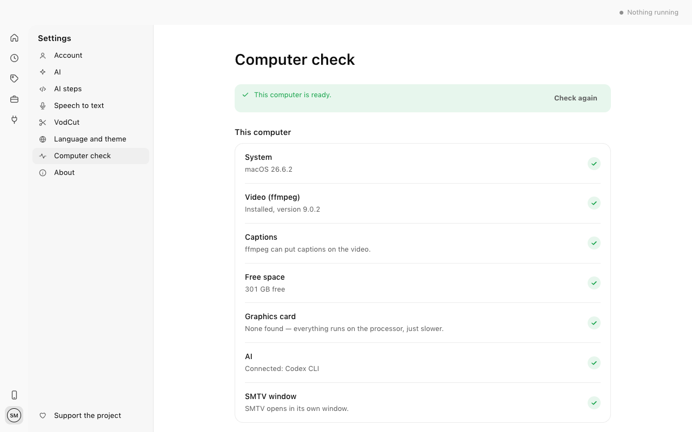

<!-- languages -->
[Русский](../troubleshooting.md) · [English](../en/troubleshooting.md) · [Қазақша](../kk/troubleshooting.md) · [Oʻzbekcha](../uz/troubleshooting.md) · [Azərbaycanca](../az/troubleshooting.md) · [Кыргызча](../ky/troubleshooting.md) · **简体中文** · [日本語](../ja/troubleshooting.md) · [한국어](../ko/troubleshooting.md) · [Tiếng Việt](../vi/troubleshooting.md) · [Bahasa Indonesia](../id/troubleshooting.md) · [हिन्दी](../hi/troubleshooting.md) · [বাংলা](../bn/troubleshooting.md) · [Español](../es/troubleshooting.md) · [Português](../pt-BR/troubleshooting.md) · [Deutsch](../de/troubleshooting.md)

> 🌐 本页面由机器自动翻译。欢迎帮助改进：[Weblate](https://hosted.weblate.org/engage/smtv/) · [pull request](https://github.com/yuriti/clipit/pulls) · [原文: Русский](../troubleshooting.md)。

# 出问题了

## 1. Computer check → Fix（电脑检查 → 修复）

**Settings → Computer check**（设置 → 电脑检查）会查看 SMTV 需要的一切，并逐行告诉你哪些正常、哪些不正常。
问题旁边有一个 **Fix** 按钮：SMTV 会自己安装或修复它能处理的部分，并显示它在做什么。

| 这一行显示 | 怎么办 |
|---|---|
| 缺少 **Video (ffmpeg)** | 点 **Fix**：SMTV 会安装它使用的视频工具 ffmpeg。 |
| **Captions**（字幕）不能用 | 点 **Fix**：SMTV 会安装一个能绘制字幕的 ffmpeg。 |
| **AI**：没有接入任何 AI | 在 **Settings → AI** 里选一个——[选哪个](connect-ai.md)。 |
| **Connection to StreamMoment**（与 StreamMoment 的连接）失败 | 检查网络；VPN 或防火墙可能会阻止它。没有它，文件照样能用。 |
| **Free space**（可用空间）不足 | 腾出一些磁盘空间：一场 6 小时的直播在处理时需要大约 20 GB。 |
| **Speech to text**：有模型没下载 | 第一次任务时会自动下载；或者在 **Settings → Speech to text** 里点 **Download**。 |

需要管理员密码的修复永远不会悄悄运行：SMTV 会打开一个带着命令的终端，让你看到它在做什么。

## 2. 常见问题

- **链接不能用。** 链接需要 [StreamMoment 账户](account.md)。没有账户？自己下载录像，把文件交给 SMTV。
- **没有切片，或者非常少。** SMTV 只保留 AI 评为好的时刻。短的或比较安静的直播可能只有几个。
  你电脑上的免费 AI 找到的好时刻比云端的少。
- **“请求过多”（«Too many requests»）。** 你的 AI 服务的免费套餐达到了限额：等一等，或者用付费套餐或账户。
- **手机打不开 SMTV。** 同一个 Wi-Fi、不用 VPN、在防火墙里允许 SMTV——见[手机](phone.md)。
- **Windows：终端拒绝运行 `smtv`。** 这是智能应用控制（Smart App Control）；请从图标启动 SMTV。
- **窗口和 SMTV 断开了连接。** 关掉窗口，再重新打开 SMTV。

停下来的任务可以继续：点 **Continue**（继续）——SMTV 会从同一步接着做，已经做完的不会重做。

## 3. 报告问题

还是不行？告诉我们——这对大家都有帮助。

1. **Settings → Computer check → Report a problem**（设置 → 电脑检查 → 报告问题）（**Report…** 按钮；在 **Settings → About** 里也有），
   或者失败任务下方的按钮。
2. SMTV 会显示报告里包含什么：版本、电脑检查结果、设置和日志。**密钥和令牌会被删掉**，你的主文件夹显示为 `~`。
   链接和文件名不会放进去，除非你勾选那个选项。
3. 点 **Save and open GitHub**（保存并打开 GitHub）。SMTV 会保存压缩包，浏览器里会打开一个已填好摘要的新 issue。
   把压缩包拖进去，点 **Submit**。

SMTV 不会自动发送任何东西。不用窗口的话：在终端里运行 `smtv report`。你也可以直接
[创建一个 issue](https://github.com/yuriti/clipit/issues/new?template=bug.yml)。
